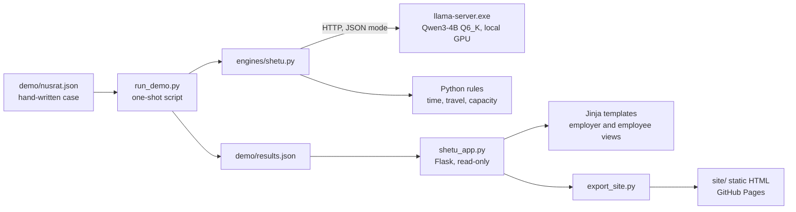
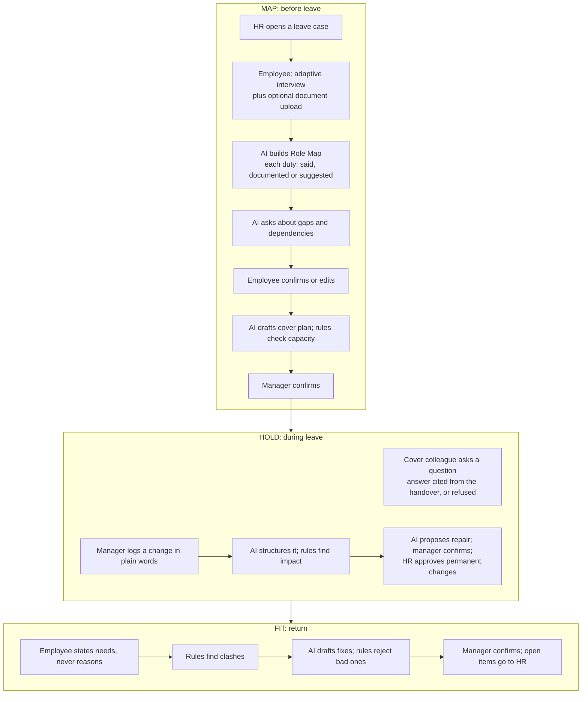
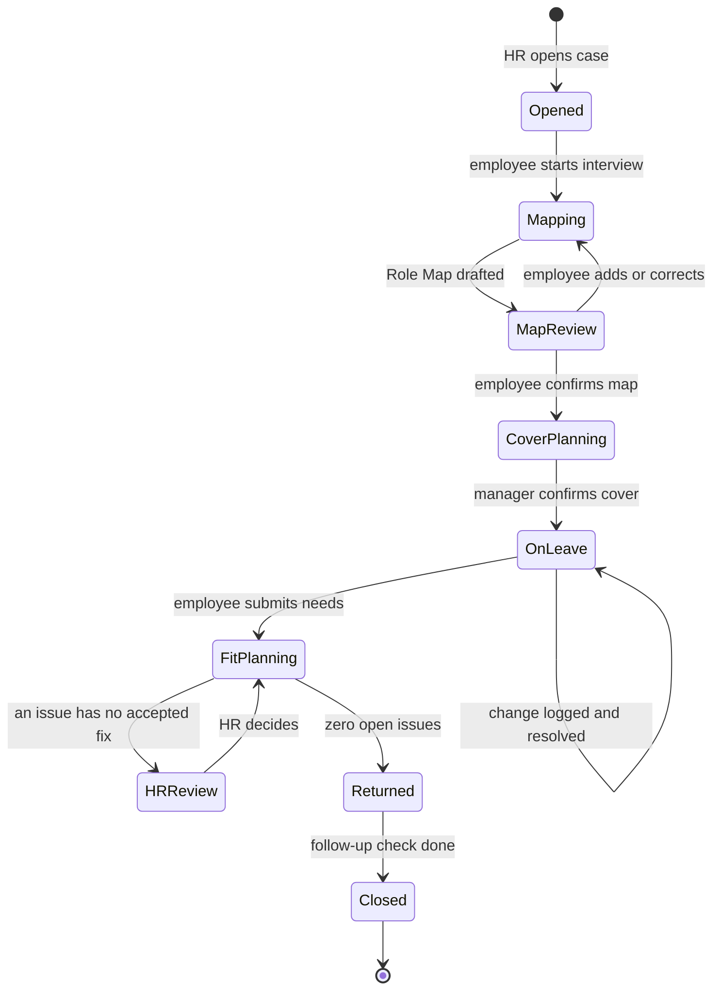
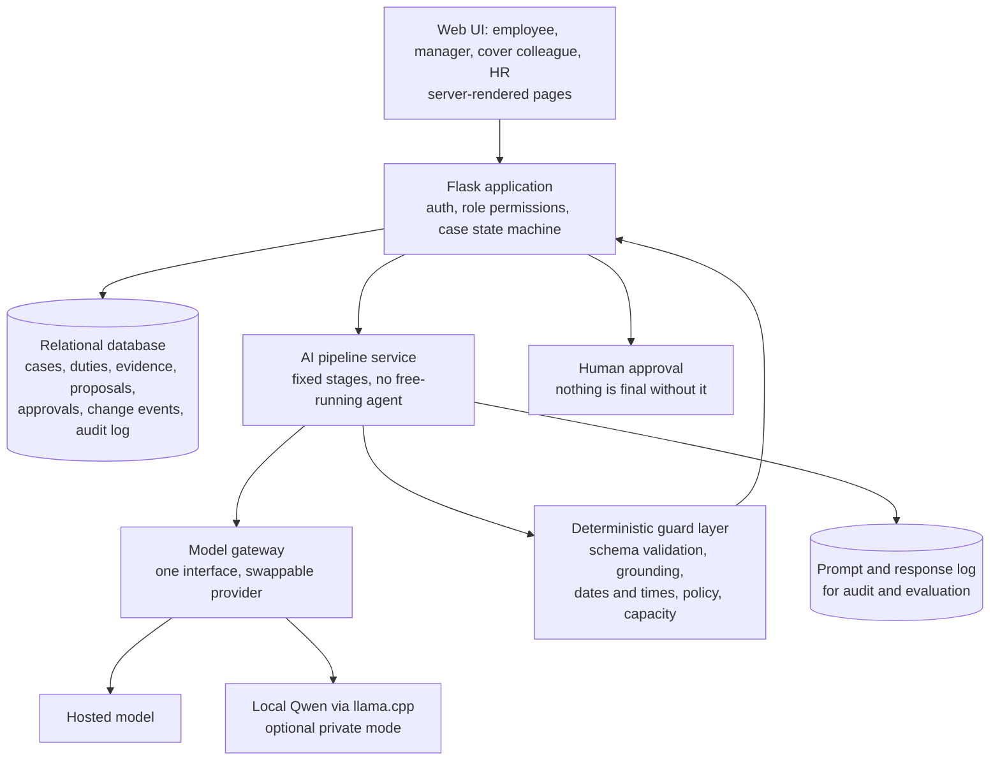
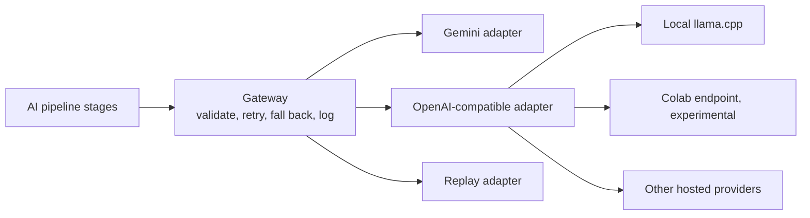
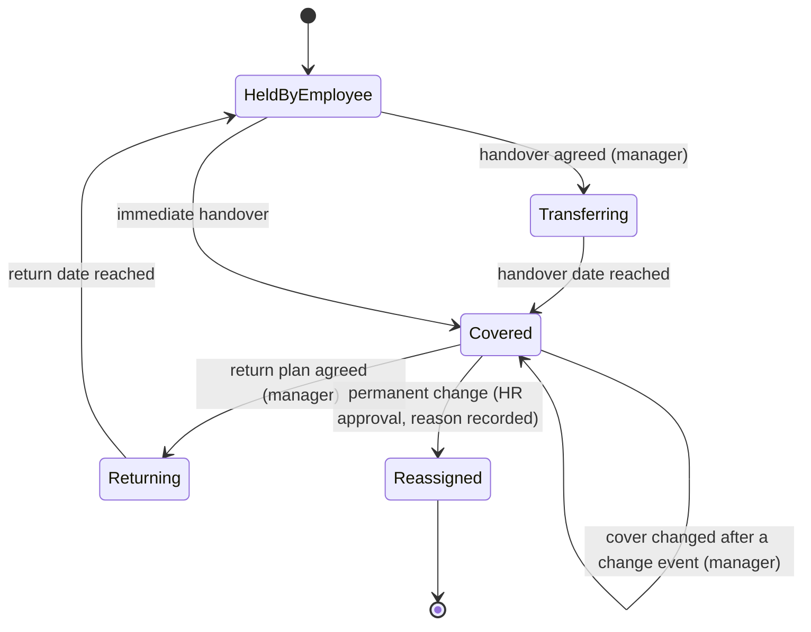

# Shetu for CSE 3422: Investigation Report

Prepared 12 November 2026; **Revision 3, 12 November 2026** (see `CHANGELOG.md`). Investigation and planning only. No file in the original Shetu project was modified. Paths such as `prototype/...`, `Final/...` and `Materials/...` in this report refer to that project; copies of the files that matter are in this folder under `reference/` (prototype code in `reference/competition-prototype/`, competition documents in `reference/competition/`).

Companion files in this folder:

- `02-Requirements-Traceability-Checklist.md`: every academic requirement, its source, and its status.
- `03-Pitch-Preparation-Pack.md`: paste-ready content for the Excel sheet and the pitch slides.
- `04-Workbook-Submission-Draft.xlsx`: a copy of the faculty workbook with Shetu's draft entries filled in. The original workbook is untouched.
- `CHANGELOG.md`: what changed in Revision 2 and why.

**Reading order after Revision 2.** Sections 1 to 18 are the original investigation, corrected where your decisions changed them. Sections 19 to 26 are new: model strategy and cost, the Hourglass Model, scope tiers and effort, the roadmap, the evaluation framework, explainability standards, team collaboration, and remaining decisions. Where an older section and a new one overlap, the new one governs and the older one says so.

How to read the labels used throughout:

| Label | Meaning |
|---|---|
| IMPLEMENTED | Code exists, and there is a saved output showing it ran |
| PARTIAL | Code exists but depends on hard-coded demo values, or was never run on real input |
| MOCKED | The screen shows it, but nothing computes or stores it |
| PROPOSED | Described in documents only |
| NOT IMPLEMENTED | Neither code nor a concrete design exists |

---

## 1. Executive Summary

**What Shetu is today.** A competition prototype, not an application. It consists of a Python pipeline that runs once over one hand-written demo case (Nusrat, "Bank Alpha"), saves the output to a JSON file, and a Flask site that displays that file. There is no database, no login, no data entry, no tests, and no git repository for the source. The pipeline itself is real: a local Qwen3-4B model extracts duties from a Banglish conversation, compares them with a job description, and drafts fixes that Python rules then accept or reject.

**What the faculty expects.** The lab slides require a product "with AI at its core", built on one shared GitHub repository with a branch and pull request per feature, with Selenium tests on the key user flows, delivered in usable increments, and shown as a live working demo at a Project Show. The pitch requires an elevator pitch, clearly defined features, a USP, a clear architecture direction, and an understanding of the tech stack.

**What the Excel workbook requires.** Less than expected. The local copy is a nearly empty template: one visible sheet, no hidden sheets, six column headers (Team Name, Members, Idea, Elevator Pitch, Project Features, USP) and a small example showing that features should be broken down as Module, Sub-module, Features, Description. It contains no length limits, dates, or scoring criteria.

**Is the current version AI-native?** Only partly. If the AI were removed, the Map stage would collapse, because nothing else can turn free-form Banglish speech into a structured role map. But Hold has no AI at all (it is a static list), and in Fit the rules did most of the work: of the three fixes chosen in the saved run, two were produced by rules and only one by the model. A faculty member could fairly describe the current build as a rules engine with an LLM at the front door.

**Recommendation (confirmed in Revision 2).** Build Direction 2, the **Shetu Evidence Map**, as a real multi-user web application around one shared object: an evidence-backed Role Map whose duties change owner over time. Every duty is linked to the words or the document it came from, marked as said, documented or suggested, and confirmed by a person. The **Hourglass Model** describes how ownership of those duties narrows before leave and widens again on return; Map, Hold and Fit are the three stages that manage it (section 20). AI builds and maintains the map and proposes every transition; rules guard it; people approve it.

**What Revision 2 settled.**

- **Model strategy** (section 19): a provider-independent gateway; a hosted model as primary, local Qwen as fallback and private mode, Colab as experiment only. The final provider is chosen by a bake-off on the synthetic evaluation set, which has not been run. Expected hosted cost for the whole term is a few US dollars to a few tens of dollars on a suitable model, and zero on a free tier while the data is synthetic.
- **Hourglass Model** (section 20): adopted as the shape of the product, not as an extra layer of stages, and without fixed percentages.
- **Scope** (section 21): the core MVP is estimated at 183 to 269 team-hours, which is at or above what a four-person team can plausibly give. Pre-agreed reductions are listed.
- **Hold-stage intelligence moves earlier** (section 22): change understanding and re-planning is demonstrated by Update 2 (60%), with a technical spike before Update 1.
- **Evaluation** (section 23): a synthetic dataset in Bangla, English and Banglish with six metrics. No results exist yet and none are claimed.
- **Explainability** (section 24): commenting standards, `CODE-EXPLANATION.md`, `AI-USAGE.md`, and a teaching brief for every major module.
- **Team collaboration** (section 25): GitHub workflow, preliminary unassigned roles, genuine-contribution rules, `CONTRIBUTIONS.md`, and Claude as mentor, not author.

**The three biggest risks.**

1. **Time and capacity.** The core MVP only fits if the team's hours are at the upper end of the assumption.
2. **Model quality on Banglish and on structured output.** Unknown until the bake-off; this is why it happens in the first iteration.
3. **Evidence.** All data is synthetic and written by the team. Results must be reported as such.

**Remaining decisions** are in section 26.

---

## 2. Academic Requirements Analysis

### 2.1 Documents found and read

| Document asked for | File found | Read in full | Notes |
|---|---|---|---|
| Lab Manual | `Lab Manual.pdf` (25 slides, Class 01) and `Lab Manual 2.pdf` (36 slides, Class 02) | Yes | Both are lecture slide decks, not a traditional manual. Text extracted from every page. Slide images were not separately inspected; each slide's text layer was complete |
| Project Pitch Presentation | `Project Pitch Presentation.docx` | Yes | Five lines under "THINGS TO REMEMBER". File metadata shows it was created on this machine on 12 Nov 2026, so it is likely typed up from an announcement, not issued by the faculty as a file |
| Course Outline | `Course Outline.pdf` (4 pages) | Yes | Official UIU syllabus for CSE 3422 |
| Excel workbook | `SE LAB SECTION E PROJECT TEAM.xlsx` | Yes, including the raw XML | One visible sheet, no hidden sheets, no comments, no data validation, no images |

Also present in the course folder: a `crud/` directory with a PHP and MySQL (XAMPP) CRUD demo from the CRUD lab. It is teaching material for Class Test 1 and does not mention the project.

### 2.2 What each document actually says

**Course Outline.** Course outcomes: work as an individual and team member (CO1), design and develop software (CO2), use modern software engineering tools (CO3), apply modern techniques (CO4), present the term project (CO5). Marks: attendance 5%, class tests 40%, project proposal presentation 10%, three project updates 20%, project report 10%, project final update 15%. So the project carries 55% of the course. Lab sequence: 1 Introduction, 2 CRUD, 3 CT1, **4 Project Proposal Presentation**, 5 Git, 6 CT2, **7 Project Update 1 (30%)**, 8 Testing, **9 Project Update 2 (60%)**, 10 CT3, **11 Final presentation (100%)**, 12 Report. Textbook: Pressman, *Software Engineering*, 8th edition.

**Lab Manual, Class 01.** The project rules are here:

- "Build a product with AI at its core. Every project must ship AI-enabled, AI-powered features. Even a dedicated chatbot counts, as long as it solves a real problem well."
- AI tools are encouraged for building, with conditions: understand every line you submit, be able to explain and modify it live, verify outputs, note which tools you used and where, and show your AI workflow at the Project Show.
- GitHub: one shared repository per team, small frequent commits, a branch and pull request per feature, "history shows who built what". Issues, clear commits and PRs keep the team in sync.
- Selenium: script key user flows as tests, run them before every demo and merge.
- Product management: define the problem and users, write each feature as a user story, prioritise must-have against nice-to-have and "cut ruthlessly", build in iterations with the "core AI feature first", test and demo.
- For every feature be ready to answer: who is it for, what problem does it solve, how do we know it works.
- Project Show: a live working demo ("not slides about a demo"), the AI feature and how it works, the GitHub history, the Selenium tests "running green", and the product decisions ("what you built, cut and why").
- Agile guidance: fix time and flex scope, estimate in ranges and size features relatively, show a usable version every iteration.

**Lab Manual, Class 02.** Background teaching on six software types (ERP, CRM, e-commerce, LMS, HMS, on-demand) and payment systems. Relevant ideas the faculty has now taught and may ask about: role-based access control checked on the server ("hiding a button is not security"), audit trails, approval workflows, state machines, privacy and consent for sensitive data, and four payment questions for every project ("Do you need payments at all?").

**Project Pitch Presentation.docx.** Five instructions:

1. Slides must be clean and professional; only Canva or PPTX is accepted; present in full-screen mode.
2. Have an elevator pitch ready, clearly defined features, and a proper USP.
3. All team members have to be present.
4. Have a clear direction of the project's architecture and breakdown, and understand the tech stacks you will use.
5. Full formal dress, including formal shoes and a belt.

**Excel workbook.** Row 1 headers: Team Name, Members, Idea, Elevator Pitch, Project Features, USP. Rows 8 to 14 hold a worked example of the expected feature breakdown: columns Module, Sub-module, Features, Description, with the example "User / Order Food / View, Search" and "User / Order Transport / Destination, Fare". Everything else is empty. You have since confirmed that the live Google Sheet has the same requirements, so this workbook is treated as the correct submission template.

### 2.3 Consolidated requirements matrix

Type key: M mandatory, R recommended, O optional, P presentation-specific, T technical, U unclear.

| # | Requirement | Source | Exact expectation | Required deliverable | Type |
|---|---|---|---|---|---|
| 1 | AI at the core | Lab Manual 1, slide 6 | "Every project must ship AI-enabled, AI-powered features" | A working AI feature that the product depends on | M, T |
| 2 | Shared GitHub repo | Lab Manual 1, slides 5, 23, 24 | One repo per team; small frequent commits; branch and PR per feature | Repository with per-member history | M, T |
| 3 | Selenium tests | Lab Manual 1, slides 5, 7, 8 | Key user flows scripted; run before every demo and merge; shown green at the Project Show | Selenium test suite | M, T |
| 4 | AI-use transparency | Lab Manual 1, slide 4 | Note which tools were used and where; show the AI workflow; explain and modify code live | AI usage log; every member able to explain the code | M |
| 5 | User stories | Lab Manual 1, slide 7 | "Write each one as a user story" | Backlog of user stories | M |
| 6 | Prioritisation | Lab Manual 1, slide 7 | Must-have against nice-to-have; "cut ruthlessly" | Prioritised backlog and a cut list | M |
| 7 | Iterative delivery | Lab Manual 1, slides 7, 21 to 23 | Small usable increments, core AI feature first, demo every iteration | Usable version at each update | M |
| 8 | Relative sizing, range estimates | Lab Manual 1, slides 15, 16, 23 | Size features relatively; re-estimate each iteration | Sized backlog | R |
| 9 | Live demo | Lab Manual 1, slide 8 | "A live, working demo, not slides about a demo" | Running product at the Project Show | M, P |
| 10 | Product decisions | Lab Manual 1, slide 8 | "What you built, cut and why" | Decision log | M, P |
| 11 | Proposal presentation | Course Outline, lab 4, 10% | Presentation | Slide deck and delivery | M, P |
| 12 | Three project updates | Course Outline, labs 7, 9, 11 | 30%, 60%, 100% | Demonstrable progress at each | M |
| 13 | Project report | Course Outline, lab 12, 10% | "Report" | Written report | M, U (format unknown) |
| 14 | Slides format | Pitch docx | Clean and professional; Canva or PPTX only; full-screen | Deck in Canva or PPTX | M, P |
| 15 | Elevator pitch | Pitch docx; Excel column E | "Make ready an elevator pitch" | Spoken pitch and written cell | M, P, U (length unknown) |
| 16 | Defined features | Pitch docx; Excel column F and rows 8 to 14 | "Clearly defined features"; Module, Sub-module, Features, Description | Feature breakdown table | M, P |
| 17 | USP | Pitch docx; Excel column G | "A proper USP" | USP statement | M, P |
| 18 | Architecture and tech stack | Pitch docx | "Clear direction of the project's architecture and breakdown, and understand the tech stacks" | Architecture slide; each member can explain the stack | M, P |
| 19 | Attendance | Pitch docx | All members present | Everyone attends | M, P |
| 20 | Dress code | Pitch docx | Full formal, formal shoes and belt | Formal dress | M, P |
| 21 | Team name, members, idea | Excel columns B, C, D | Fill the cells | Sheet entries | M |
| 22 | Payments consideration | Lab Manual 2, slide 32 | "Do you need payments at all?" and three follow-ups | A prepared answer | R |
| 23 | RBAC on the server, audit trail, approvals, state machines | Lab Manual 2, slides 8, 14, 17, 20, 30 | Taught as core ideas; not stated as project requirements | Natural to demonstrate | R |
| 24 | Show to real users | Lab Manual 1, slide 7 | "Selenium tests, then show it to real users" | User feedback session | R |
| 25 | Three product ideas | Lab Manual 1, slide 24 | "Bring [3] product ideas", bracket left as placeholder | Possibly already past | U |

### 2.4 What is unclear or missing

- **No pitch length, slide count, or elevator pitch length** appears in any document. Your working estimate is 5 to 10 minutes; this is provisional, not official.
- **Dates.** The proposal presentation is on **15 November 2026** (from you; not in any file). The dates of the updates, the final and the Project Show are still unknown. Maximum team size is four (from you).
- **No report format.** The outline says only "Report".
- **UML, use-case models, design patterns** are not mentioned anywhere in the four documents. See section 13.

### 2.5 The verbal "AI-native" requirement against the written requirement

These are two different bars and should be kept apart.

| | Written (Lab Manual, Class 01, slide 6) | Verbal (as reported in your brief) |
|---|---|---|
| Wording | "Build a product with AI at its core. Every project must ship AI-enabled, AI-powered features. Even a dedicated chatbot counts, as long as it solves a real problem well." | The project must be "AI-native": AI is the central capability, not an optional chatbot, a decorative feature, or a simple API call |
| Where it can be verified | In the slide deck | Nowhere in the files. I am relying on your account of what was said |
| Does a chatbot qualify? | Yes, explicitly | No |
| Does the current Shetu prototype meet it? | Yes, if it were a working application: it has real AI features | Only partly (section 5 and the test in section 11) |

The course outline, the pitch note and the workbook say nothing about AI at all. **I have designed to the stricter verbal bar**, since meeting it also meets the written one. If the instructor's actual wording differs from your recollection, the design is still safe; the only cost is some extra AI work in the Hold stage.

### 2.6 The Section C and Section E discrepancy

What can be verified from the files:

| Fact | Evidence |
|---|---|
| The outline states Section C | Course Outline page 1, row 6. Also Saturday 2:00 to 4:30, room 523 |
| The outline states trimester "Summer 2026" | Page 1, row 3. The other course files are dated November 2026, which is not a summer trimester |
| The outline is a copy | Its PDF title is "Copy of Software Engineering Lab Outline.docx", exported from Google Docs |
| "Section E" appears only in the workbook's file name | No cell in the workbook mentions a section. Neither slide deck nor the pitch note mentions one |
| Same instructor | The outline and both slide decks name Zobaer Ibn Razzaque |

Conclusion: the discrepancy is real, and the most likely explanation is that the outline you hold is a copy made for a different section and an earlier trimester. I cannot confirm that from the files alone. Treat the outline's **section-specific fields as unreliable** (section, day, time, room, trimester, and therefore any dates you might infer). Its **general content** (course outcomes, marks distribution, lab sequence) probably applies to all sections under the same instructor, but confirm the marks split and the lab sequence for Section E before planning around them.

---

## 3. Existing Shetu Project Audit

### 3.1 What is in the folder

| Folder | Contents |
|---|---|
| `Final/` | Competition documents (Product Brief, Judge Q&A Prep, Team Roadmap), the Round 2 deck, and reference decks from other teams |
| `Materials/` | Earlier drafts, logos, and `HANDOFF - Shetu Round 2.md`, the most accurate status document |
| `prototype/` | All code, a 3.3 GB model file, and bundled llama.cpp binaries |
| `Videos/` | Round 1 pitch videos |

The project root is **not a git repository**. The only git history is in `prototype/site/`, a static export with two commits from 16 Oct 2026, pushed to `github.com/SpicyFalcon619/shetu-prototype` for GitHub Pages.

### 3.2 Two prototypes live side by side

The code contains two generations, built for two different product concepts.

**Generation 1 (14 Oct), the old concept: voice handover.** Entry point `prototype/app.py`. A spoken handover is transcribed, structured, approved, then queried.

**Generation 2 (16 Oct), the current concept: Map, Hold, Fit.** Entry points `prototype/run_demo.py` (runs the pipeline) and `prototype/shetu_app.py` (displays the result).

The handoff note says Generation 1 is obsolete. I disagree in part: its question-answering engine and its number-grounding checks are better engineered than anything in Generation 2 and are worth carrying forward.

### 3.3 Product audit

- **Problem.** Around a long leave, work is dropped, the absent person's role erodes, and the job she returns to no longer fits. Nobody owns the full picture of her job.
- **Users.** The employee going on leave, her manager, the covering colleagues, and HR. The buyer is the head of HR.
- **Core workflow.** Map her real job before leave, Hold it during leave, Fit it to her needs on return, then check at day 45.
- **What makes it valuable.** The claim that it finds work nobody listed, and that every proposal is checked against team capacity and policy before a person approves it.
- **Current limitations.** No one can use it. There is one case, entered by editing a JSON file. No interviews with HR staff or returning mothers have been done; the competition documents say so plainly, and that is still true.

### 3.4 Feature-by-feature classification

| # | Capability from the brief | Status | Evidence |
|---|---|---|---|
| 1 | Understand Bangla, English, Banglish conversation | PARTIAL | Typed Banglish works in the saved run. Bangla script worked in one Generation 1 dev run. Voice: Whisper code exists in `engines/handover.py`, with no saved evidence of a run on a real recording |
| 2 | Extract responsibilities from conversation | IMPLEMENTED | `engines/shetu.py` `map_role`; five duties in `demo/results.json` |
| 3 | Generate a structured Role Map | IMPLEMENTED | Fixed JSON shape with a supporting quote per duty |
| 4 | Compare against the job description | IMPLEMENTED, narrowly | `cross_check` found the one missing duty. Its false-alarm filter uses a stop-word list tuned to this one job description |
| 5 | Identify forgotten responsibilities | PARTIAL | Detection and the follow-up question come from the model. What happens next is scripted: `run_demo.py` looks for the word "quarter" and inserts a fully hand-written duty with a pre-written answer |
| 6 | Generate handover suggestions | PARTIAL | Generation 1 builds a structured handover. Generation 2 has no cover-plan generator; the "Cover during leave" column in the case view is hard-coded in the template by keyword |
| 7 | Check workload conflicts and capacity | PARTIAL | `check_fix` compares hours against `spare_hours` typed into the JSON. Clash hours are constants (2 and 4). One message hard-codes the name "Rafiq" |
| 8 | Deterministic policy and approval rules | PARTIAL | Policy rules exist for time and travel. **Approval is MOCKED**: the Confirm button changes colour in the browser and saves nothing |
| 9 | Separate interfaces for manager, employee, HR | MOCKED | Different URLs and layouts, no login, no permissions. All pages read the same file |
| 10 | Return-to-work planning | PARTIAL | Clash detection and fix proposals ran. The employee's needs are fixed in JSON; the chips on the Fit screen toggle visually and do nothing. The home-day need is never checked by any rule |
| | Hold stage change log | MOCKED | Three static entries in `demo/nusrat.json` |
| | Day-45 check | PROPOSED | Text on a screen only |
| | HR overview of all leaves, report numbers | MOCKED | `demo/cases.json`, labelled illustrative |
| | Ask-the-Handover Q&A (Generation 1) | IMPLEMENTED, not connected | `engines/qa.py`, with two refusal gates; ran on one dev transcript |
| | Phased return plans (Generation 1) | IMPLEMENTED, not connected | `engines/return_plan.py`, rule-built plans with written reasons |
| | Catch-up summary in Bangla (Generation 1) | PARTIAL | `engines/catchup.py`, nine lines, no validation, no saved run |
| | Evaluation harness | PARTIAL | `eval/run_eval.py` and three answer-key job cards exist. The sample folders are empty and no results folder exists, so it never ran on real recordings |

### 3.5 Claims in the competition documents that the code does not support

These matter because the lab's rule is that you must be able to explain and defend everything.

| Document says | Reality |
|---|---|
| "Built on leading large language models" (Product Brief) | A 4-billion-parameter open model on one laptop. The handoff note already flags this |
| "A 15-minute AI conversation" | Three fixed questions with pre-written answers. The system never asks a question of its own during the conversation |
| "Move to 3:00 pm" for the Tuesday meeting | The model proposed 16:00 to 17:00 |
| "Cross-checks against the role's recurring cycles" | Not implemented. Only the job description is compared |
| "Personal details deleted after the 45-day check" | No storage exists, so no deletion exists |
| "Each person sees only what they need" | No access control exists |
| Voice input | No evidence of a run on recorded speech |

---

## 4. Current Architecture and Technology Stack

| Layer | What exists |
|---|---|
| Frontend | Server-rendered Jinja templates with inline CSS, Lucide icons from a CDN, about three lines of JavaScript. No forms, no inputs, no network calls |
| Backend | Flask, ten GET routes that render the same two JSON files, one POST route that re-runs the script. A catch-all route renders any template name from the URL and throws a 500 on `/favicon.ico` (visible in `data/app.log`) |
| Data | JSON files. No database, no schema, no migrations |
| AI | `engines/llm.py`: starts a bundled Windows `llama-server.exe`, calls its OpenAI-compatible endpoint at temperature 0 in JSON-object mode, retries once if the reply does not parse |
| Other models | faster-whisper large-v3 for speech and `intfloat/multilingual-e5-small` for embeddings, both in Generation 1 only |
| External APIs | None. Everything is offline |
| Authentication, authorisation | None |
| Validation | Quote grounding by fuzzy match (threshold 0.6); number grounding and Bangla numeral handling in Generation 1; clock times parsed by rule, not by the model |
| Tests | None. `dev_test.py` is a print script. A Playwright script exists only to take screenshots |
| Deployment | Static export of saved pages. The AI does not run in the deployed site |
| Dependencies | No `requirements.txt`. Python 3.14, Flask, and for Generation 1 torch, transformers and faster-whisper |
| Portability | Windows only, NVIDIA GPU only. The model file is 3.3 GB |

---

## 5. Current AI Capabilities Assessment

All model calls use Qwen3-4B-Instruct (Q6_K GGUF) through llama.cpp at temperature 0. Temperature 0 makes output repeatable on the same machine, but the output is still a model's guess, so I class every model step as probabilistic.

| AI feature | Input | Processing | Output | Implemented | Validation | On failure |
|---|---|---|---|---|---|---|
| **Role Map extraction** (`map_role`) | Q&A turns as text | One prompt, JSON mode | List of duties with frequency, day, time, due date, place, clients, criticality, quote | Yes | Quote must fuzzy-match her words; client codes filtered by regex; times re-parsed by rule | Low match sets `grounded: false`. The flag is stored but **the interface never shows it and nothing blocks on it**. A missing `duties` key crashes the run |
| **Job description cross-check** (`cross_check`) | Duty names plus JD lines | One prompt, JSON mode | Missing JD duties, each with a question | Yes | A keyword-overlap rule drops "missing" items that share two words with a mapped duty | A wrong match silently hides a real gap; there is no path for a person to see what was dropped |
| **Fix proposals** (`propose_fixes`) | Clash list, colleague names, one policy line | One prompt, JSON mode, four allowed action types | Two or three options per clash | Yes | `check_fix` rules test each option against time, travel and capacity | Rejected options are shown with the reason; if all fail, a rule picks the colleague with the most spare hours |
| **Handover structuring** (Gen 1, `build_handover`) | Transcript | Numerals normalised by rule, then one prompt | Six-section handover with quotes | Yes, one dev run | Quote match, and every number in an item must appear in the quote | Item flagged with a reason for her to check |
| **Ask-the-Handover** (Gen 1, `qa.answer`) | A question in any of the three language forms | Rewrite to English, embed, retrieve top 4, answer with citations | Answer with sources, or a refusal | Yes, one dev run | Retrieval gate (similarity below 0.80 refuses) and citation gate (no valid cited passage refuses) | "Not in her handover. Sent to the manager. She will not be contacted." |
| **Task tagging** (Gen 1, `tag_tasks`) | Handover tasks | One prompt | Fixed or flexible, office or remote, movable or not | Yes | Clock time overwritten by rule | Missing hours default to 1 |
| **Catch-up** (Gen 1) | Free-text updates | One prompt | Bangla summary | Code only | None | None |
| **Speech to text** (Gen 1) | Audio file | Whisper large-v3, Bangla, office-vocabulary hint | Transcript | Code only | None | None |

### What the one saved run shows

The saved run (`demo/results.json`, 22.3 seconds) is the only evidence of the current concept working. Reading it closely:

- **Five duties extracted, all with matching quotes.** Good.
- **One extraction error that nothing caught.** She said the monthly portfolio report "ghore bose o kora jay" (can also be done from home). The model recorded the place as "office". The quote check passed because the quote is genuine; the check verifies that the words exist, not that the fields agree with them.
- **One lossy field.** She said calls are "mostly Sunday ar Monday"; the day field holds only "Sunday".
- **Of three chosen fixes, the model supplied one.** The meeting move was the model's. The Tania reassignment was the rule fallback after the model suggested overloaded Rafiq. The "start 3 days earlier" fix is a constant inside the `rank` function.
- **The dropped-work alert only fires for duties with named clients.** A critical duty with no cover and no client list produces no alert.

**Bottom line.** The pattern (model proposes, rules check, person decides) is sound and worth keeping. The implementation is fitted to one case, and the most impressive moment in the demo is partly scripted.

---

## 6. Problems and Limitations

**Product**

1. **The job description is a weak source for finding forgotten work.** Real job descriptions are generic and often end with "any other duties as assigned". The demo's job description was written to contain the missing duty. On real documents this check will find little.
2. **No real-user evidence.** No interviews, no pilot. This is acknowledged in the team's own documents and must stay acknowledged.
3. **Capacity is a number a manager types.** "Spare hours" is a guess. That is acceptable, but it should be presented as the manager's estimate, not as a measurement.
4. **Hold has no intelligence.** The stage where plans actually go wrong is a static list.

**Technical**

5. No persistence, no users, no input. It cannot be used by a second person.
6. Demo values are hard-coded in logic (`"quarter"`, `"Rafiq"`, "until December", three days, two and four hours) and in templates.
7. Windows and GPU only. A teammate without the same hardware cannot run the AI.
8. No tests, no dependency list, no version control for the source.
9. The grounding check is shallow, as the "office" error shows.
10. A 4B model is small for this task. The handoff note records that it got dates and clock times wrong, which is why those moved to rules.

**For this course specifically**

11. **The GitHub history must show who built what.** The existing code has no history. Starting the course repository with one large import would hide the team's work; see section 18 for how to handle it.
12. **"Understand every line."** `samples/dev/README.txt` states the dev sample was written by Claude, and the code style suggests the engines were AI-assisted. That is allowed, but every member must be able to explain and change the rules and prompts live.
13. **No Selenium-testable flow exists**, because there are no forms.

---

## 7. Opportunities for AI-Native Expansion

Each opportunity from the brief is assessed for whether AI is the right tool.

### A. Intelligent role understanding: strong, and should be the centre

Build the Role Map from several sources, not one conversation. Useful sources, in order of value for effort:

| Source | Value | Effort | Verdict |
|---|---|---|---|
| Adaptive conversation (system asks follow-ups) | High | Medium | Build |
| Job description | Low to medium | Already built | Keep |
| An existing handover note or SOP document she uploads | High | Medium | Build |
| A task or calendar export as CSV | High: it shows what recurs, with real days and times | Medium | Build if time allows |
| Live calendar, email, or ticketing integrations | High | Very high, and a serious privacy cost | Do not build |

The valuable output is a **discrepancy view**: what the documents say she does, what she says she does, and where they differ. That is a concrete thing a manager has never seen before.

### B. Contextual responsibility discovery: strong, with one firm rule

Three techniques, all realistic:

1. **Role-cycle prompting.** Given her role and industry, the model suggests recurring obligations that people in such roles commonly have (quarter-ends, audits, renewals) and turns each into a question.
2. **Dependency extraction.** Phrases like "the statements are only in my email" or "only I have access" mark a single point of failure. The demo conversation contains exactly this, and the current system ignores it.
3. **Cross-source gaps.** A recurring calendar entry with no matching duty becomes a question.

The firm rule: **nothing the model suggests is ever stored as a duty until she confirms it.** Each item carries one of three statuses: *said* (has a quote), *documented* (has a source document location), or *suggested* (unconfirmed, shown as a question). This is how the system distinguishes fact from assumption, and it should be visible on screen.

### C. Intelligent handover generation: moderate

The model is good at writing a readable handover brief per duty for the covering colleague, and at proposing who might cover with a reason. It is bad at arithmetic and should never decide capacity. Split accordingly: model drafts and explains, rules calculate hours and enforce policy.

### D. Adaptive continuity management: the biggest gap, and a strong demo

When something changes during leave, a person describes it in a sentence ("Tania is on sick leave for three weeks from Monday", "the renewal moved to 2 April"). The model turns that into a structured change event; rules compute which duties are now uncovered or which colleague is now over capacity; the model proposes a revised cover; the manager approves; HR approves anything that permanently changes a held duty. This makes Hold a working stage instead of a list, and it reuses the same proposal-and-check machinery as Fit.

Detecting an *unassigned* responsibility or an *overloaded* colleague is pure rules and should stay that way.

### E. Intelligent return planning: moderate, mostly built

Free-text needs become structured constraints (model), clashes are found (rules), fixes are drafted (model) and checked (rules). Add a "what changed while you were away" briefing generated from the Hold log, grounded in logged events only.

The model must not judge readiness to return, and the system must never ask why she needs an arrangement.

### F. Other ideas, with verdicts

| Idea | Verdict | Why |
|---|---|---|
| Ask-the-Handover Q&A for the cover person | Build; it already exists | Directly protects the "nobody contacts her" promise |
| Bangla voice input | Stretch only | Impressive, but needs a GPU or a paid speech service, and adds a second model to debug |
| Attrition or "flight risk" prediction | Never | Profiles women; contradicts the product's own trust rules; no data |
| Sentiment analysis of the employee | Never | Same reason |
| An autonomous agent that reassigns work | Never | Removes the human approval that makes the product safe |
| General HR chatbot | No | Unrelated to the proposition; this is the "bolt-on chatbot" the faculty warned about |

---

## 8. Three Proposed Project Directions

Effort is given in team-hours as a range, with low confidence, in the spirit of the lab's own cone-of-uncertainty lesson. Re-estimate after the first iteration. **The figures in this section are the original top-down estimates; section 21 replaces them with a module-by-module estimate.**

### Direction 1: Shetu Core (realistic)

Turn the existing pipeline into a real application for one company.

- **Product.** Login for three roles. HR opens a leave case. The employee has a typed conversation and confirms her Role Map. The manager sees gaps and a cover plan and confirms. On return, the employee enters needs, the manager confirms fixes, HR sees open items. Audit log throughout.
- **AI.** The three existing model steps, generalised: extraction, job-description cross-check, fix proposals. Conversation uses a fixed question list.
- **Architecture.** One Flask application, a relational database, one model gateway.
- **Complexity.** Low to medium. Mostly conventional web development.
- **Dependencies.** A model every teammate can reach.
- **Risks.** Low delivery risk. **High risk of failing the AI-native test**: Hold still has no AI, and the conversation is a form in disguise.
- **Demo potential.** Moderate. One good moment (the missed duty).
- **Academic relevance.** Strong on CRUD, RBAC, workflow, testing. Weak on AI depth.
- **Effort.** 120 to 180 team-hours.

### Direction 2: Shetu Evidence Map (ambitious but feasible)

Direction 1, plus the Role Map becomes an evidence-backed, living record.

- **Product.** Everything in Direction 1, plus: an adaptive interview where the system chooses the next question; document upload; a discrepancy view; statuses of said, documented, suggested; dependency and single-point-of-failure flags; a working Hold stage with change events and re-planning; Ask-the-Handover for cover colleagues; a return briefing.
- **AI.** Five model components (section 11): interview conductor, extractor, evidence reconciler, gap and dependency finder, proposal generator, plus grounded Q&A.
- **Architecture.** Same single application. Adds a document text store and an evaluation harness. No vector database, no agents, no extra services.
- **Complexity.** Medium to high. The difficulty is in prompt design, validation and evaluation, not infrastructure.
- **Dependencies.** A hosted or shared model with reliable structured output; synthetic case files written before the code.
- **Risks.** Scope. Model quality on Banglish. Evaluation on self-written data.
- **Demo potential.** High. Four distinct moments: the system asks a question she did not expect; a duty appears from a document she never mentioned; a colleague goes sick and the plan repairs itself; a cover colleague asks a question and gets a cited answer or an honest refusal.
- **Academic relevance.** Strong on every course outcome, and AI is necessary in all three stages.
- **Effort.** 220 to 320 team-hours in full.

### Direction 3: Shetu Autopilot (highly ambitious)

- **Product.** Direction 2, plus live Google Calendar, email and HR-system integrations; Bangla voice interviews; an always-on agent that watches for changes and re-plans proactively; a cross-company role knowledge graph; multi-tenant deployment; the "Shetu Cover" marketplace.
- **AI.** Tool-calling agents, long-term memory, speech recognition, graph retrieval.
- **Complexity.** Very high.
- **Risks.** OAuth and third-party approval alone can consume weeks. Reading real mailboxes contradicts the product's own data-minimisation stance. Agents are hard to test with Selenium and hard to explain line by line.
- **Demo potential.** High if it works; a live integration failing on stage is the most likely outcome.
- **Academic relevance.** It would look like an AI research project with thin software engineering.
- **Effort.** 500 team-hours or more. **Not feasible in one term.** Listed for completeness and as a future-work slide.

---

## 9. Feature Prioritization Matrix

Scores are 1 to 5. For Cost and Risk, **5 means cheap and safe**, so a higher total is always better. Scores are my judgement, not measurements.

| # | Feature | AI needed | User value | Feasible | SE learning | Demo impact | Cost | Risk | Total | Decision |
|---|---|---|---|---|---|---|---|---|---|---|
| F1 | Roles, login, server-side permissions, audit log | 1 | 4 | 5 | 5 | 2 | 4 | 5 | 26 | **Must** (the spine) |
| F2 | Leave case lifecycle with approvals (state machine) | 1 | 5 | 5 | 5 | 3 | 4 | 5 | 28 | **Must** |
| F3 | Role Map extraction with quotes, confirm and edit | 5 | 5 | 5 | 4 | 4 | 4 | 4 | 31 | **Must** |
| F4 | Adaptive interview (system chooses follow-ups) | 5 | 4 | 4 | 3 | 5 | 3 | 3 | 27 | **Must** |
| F5 | Evidence statuses: said, documented, suggested | 4 | 5 | 4 | 4 | 4 | 4 | 4 | 29 | **Must** |
| F6 | Cross-check with job description and one uploaded document; discrepancy view | 5 | 5 | 4 | 4 | 5 | 3 | 3 | 29 | **Must** |
| F7 | Dependency and single-point-of-failure flags | 5 | 4 | 4 | 2 | 4 | 4 | 4 | 27 | **Should** |
| F8 | Cover plan proposals checked by capacity rules | 4 | 5 | 4 | 4 | 4 | 3 | 4 | 28 | **Must** |
| F9 | Fit: needs to constraints, clash rules, checked fixes | 4 | 5 | 5 | 4 | 4 | 4 | 4 | 30 | **Must** |
| F10 | Hold: change events and re-planning | 5 | 5 | 3 | 4 | 5 | 3 | 3 | 28 | **Must** (raised in Revision 2) |
| F11 | Ask-the-Handover with refusal gates | 5 | 4 | 4 | 3 | 4 | 4 | 4 | 28 | **Next priority** (lowered in Revision 2 to make room for F10) |
| F12 | Evaluation harness on synthetic cases | 3 | 3 | 4 | 5 | 3 | 3 | 5 | 26 | **Must** (answers "how do we know it works") |
| F13 | Role-cycle suggested questions | 5 | 4 | 4 | 2 | 4 | 4 | 3 | 26 | **Could** |
| F14 | Return briefing from the Hold log | 4 | 3 | 5 | 2 | 3 | 5 | 4 | 26 | **Could** |
| F15 | Day-45 check | 2 | 3 | 5 | 2 | 2 | 5 | 5 | 24 | **Could** |
| F16 | Task or calendar CSV as a source | 4 | 4 | 3 | 3 | 4 | 3 | 3 | 24 | **Could** |
| F17 | HR overview across all leaves | 1 | 3 | 5 | 3 | 2 | 4 | 5 | 23 | **Could** (simple list only) |
| F18 | Bangla voice input | 5 | 3 | 2 | 2 | 5 | 2 | 2 | 21 | **Cut** (stretch) |
| F19 | Live calendar, email, HR-system integration | 3 | 4 | 1 | 3 | 4 | 1 | 1 | 17 | **Cut** |
| F20 | Autonomous monitoring agent | 4 | 2 | 1 | 2 | 4 | 1 | 1 | 15 | **Cut** |
| F21 | Attrition prediction or any scoring of people | 5 | 1 | 2 | 1 | 2 | 2 | 1 | 14 | **Never** |
| F22 | Payments, billing, multi-tenant | 1 | 1 | 3 | 3 | 1 | 2 | 3 | 14 | **Cut** |
| F23 | Ownership timeline: each duty's owner by date, with the rule that no duty is ever unowned (Revision 2, from the Hourglass Model) | 2 | 5 | 5 | 4 | 4 | 4 | 5 | 29 | **Must** |
| F24 | Hourglass view: her workload over time, derived from the timeline (Revision 2) | 1 | 3 | 5 | 2 | 5 | 4 | 5 | 25 | **Next priority** |

Features that sound impressive but add little: F18, F19, F20. Features that are unglamorous but decide whether this is a software engineering project: F1, F2, F12, F23. Features that are conventional automation and should be described as such, not as AI: F1, F2, F15, F17, F23, F24. The final tiering of all rows into core MVP, next priorities, stretch and excluded is in section 21; where it differs from the Decision column here, section 21 governs.

---

## 10. Recommended Product Direction

**Direction 2, the Shetu Evidence Map.** The overall vision is the full Direction 2 in section 8. What the team commits to build is the core MVP in section 21; the rest is ordered as next priorities and stretch. Everything excluded goes on a "future work" slide.

### The single proposition

> Shetu builds an evidence-backed map of a person's real job, finds what nobody wrote down, and keeps the plan true while she is away and when she returns. AI proposes, rules check, people decide.

Every recommended feature serves that sentence. The Role Map is the one shared object: Map creates it, Hold maintains it, Fit adjusts it. Section 20 adds the time dimension: each duty in the map has an owner on every date, and the Hourglass Model is the shape those ownership changes make.

### Core workflow

### Case lifecycle (a state machine, as taught in Class 02)

### Changes to the original architecture, and why

| Change | Reason |
|---|---|
| One-shot script becomes a multi-user application with a database | Nothing can be demonstrated live, tested with Selenium, or built by a team otherwise |
| Local-only model becomes a provider-independent gateway | Teammates and a deployed demo need access. The local model stays as an optional "data never leaves the building" mode, which is a good story to tell |
| Fixed three questions become an adaptive interview | Removes the fair criticism that the conversation is a form |
| Job description as the only cross-check source becomes several sources | A job description alone rarely reveals forgotten work |
| Quote-exists check becomes field-level verification plus mandatory human confirmation | The "office" error shows the current check is not enough |
| Hard-coded demo logic is removed | It cannot survive a second case |

What stays: the principle of model proposes, rules check, people decide; quote grounding; number and clock parsing by rule; the constrained action vocabulary for fixes; the two refusal gates in Q&A.

### Positioning note

Keep maternity leave as the lead story; it is specific and it is why the product exists. Build the system for "a long leave" generally, which costs nothing extra and avoids the product marking mothers out. In the lab's own vocabulary, Shetu is a focused HR module of the kind found in an ERP, with AI as the core.

---

## 11. Proposed AI Architecture

**Shape:** one deployable application. The "AI pipeline service" is a Python module, not a separate server.

### Component-by-component

**C1. Interview Conductor**

1. *Problem:* people describe their jobs incompletely and in their own order.
2. *Why not conventional software:* a form can only ask what its designer anticipated; it cannot notice that she mentioned a monthly report but not its deadline.
3. *Needs:* the conversation so far, the current draft Role Map, a short coverage checklist (frequency, timing, place, who depends on it, where the materials are).
4. *How:* after each answer the model returns either the next question, targeted at the largest gap, or "enough". A hard cap of about ten questions.
5. *Technology:* a general chat model with structured output.
6. *Validation:* the question must reference a duty or checklist item that exists; the cap is enforced in code.
7. *When wrong:* a poor question wastes thirty seconds; she can skip any question. No data is corrupted.
8. *Complexity:* medium.
9. *Cost:* one short call per turn.

**C2. Role Map Extractor** (exists; generalise)

1. *Problem:* turning Bangla, English and Banglish speech into structured duties.
2. *Why not conventional:* no rule set parses "Protiti Tuesday sondha 6 ta theke 7:30 porjonto".
3. *Needs:* the conversation text.
4. *How:* schema-constrained output; each duty carries the exact supporting quote.
5. *Technology:* chat model with JSON-schema output; Pydantic validation.
6. *Validation:* quote must match her words; numbers, dates and clock times are re-derived by rule from the quote and override the model; a second cheap check asks, per field, "is this supported by the quote?"; she confirms or edits every duty.
7. *When wrong:* an unsupported field is shown highlighted for her attention, never hidden.
8. *Complexity:* low; most exists.
9. *Cost:* one or two calls per interview.

**C3. Evidence Reconciler**

1. *Problem:* deciding whether a line in a job description or handover note describes the same duty she talked about, in different words and possibly a different language.
2. *Why not conventional:* the existing keyword-overlap rule already needs a stop-word list hand-tuned to one document.
3. *Needs:* confirmed duties; text chunks from documents with page or line positions.
4. *How:* for each document statement the model returns matched duty, no match, or partial, with the reason. Unmatched statements become questions. Disagreements (document says weekly, she said monthly) become discrepancy items.
5. *Technology:* chat model. At this scale (one person's documents, a few pages) all text fits in the prompt, so **no vector database and no embedding index are needed**.
6. *Validation:* every claimed document statement must exist verbatim at the cited position; she answers each question.
7. *When wrong:* a false "missing" costs her one click to dismiss; a false "match" hides a gap, so matched pairs are listed for the manager to scan.
8. *Complexity:* medium.
9. *Cost:* one call per document.

**C4. Gap and Dependency Finder**

1. *Problem:* work that nobody mentions, and work only she can do.
2. *Why not conventional:* requires world knowledge about what roles typically involve, and reading intent in phrases like "only in my email".
3. *Needs:* the Role Map, her role title and industry, her own words.
4. *How:* two outputs. Suggested questions about commonly recurring obligations for such a role. Dependency flags tied to a quote.
5. *Technology:* chat model.
6. *Validation:* suggestions are stored only as questions with status *suggested*; dependency flags must quote her.
7. *When wrong:* an irrelevant suggestion is dismissed. It can never become a fact on its own.
8. *Complexity:* low to medium.
9. *Cost:* one call per case.

**C5. Proposal Generator** (exists for Fit; extend to cover plans and Hold)

1. *Problem:* drafting specific, sensible options for who covers what, how to fix a clash, or how to repair a plan after a change.
2. *Why not conventional:* rules can pick the colleague with the most spare hours but cannot weigh that a meeting can move while a site visit cannot, or write the option in words a manager will accept.
3. *Needs:* the affected duties, team members with skills and manager-entered capacity, policy settings, and for Hold the change described in plain words.
4. *How:* the model must choose from a fixed list of action types with typed parameters, so every proposal is machine-checkable.
5. *Technology:* chat model with structured output.
6. *Validation:* rules verify each option against capacity, policy and dates; rejected options are shown with the reason; a rule-made fallback exists; the manager decides.
7. *When wrong:* the option is rejected by rules, or by the manager. Nothing is applied automatically.
8. *Complexity:* medium.
9. *Cost:* one call per planning event.

**C6. Grounded Q&A** (exists in Generation 1; port)

1. *Problem:* cover colleagues need answers without contacting her.
2. *Why not conventional:* questions arrive in three language forms and never match stored wording.
3. *Needs:* the approved handover passages.
4. *How:* answer only from passages, with citations. For one person's handover, all passages can go in the prompt; the embedding retrieval step from Generation 1 becomes optional.
5. *Technology:* chat model.
6. *Validation:* an answer without a valid citation is replaced by a refusal.
7. *When wrong:* the refusal routes the question to the manager.
8. *Complexity:* low; mostly exists.
9. *Cost:* one call per question.

**C7. Deterministic guard layer** (not AI, and deliberately so)

Schema validation, quote and number grounding, date and clock parsing, leave-window arithmetic, capacity sums, policy checks, permission checks, the case state machine, and the audit log. This is where most unit tests live.

### Techniques considered and not recommended

| Technique | Decision | Reason |
|---|---|---|
| Vector database, full RAG stack | No | The corpus per case is a few pages. Put it in the prompt. Keep the citation discipline, which is the part of RAG that matters here |
| Fine-tuning a model | No | No data, no need, and it would require holding sensitive data |
| Autonomous or multi-agent workflows | No | Fixed stages are easier to test, explain and audit. An agent adds failure modes without adding value at this size |
| Tool calling | Limited | Only as the mechanism for structured, typed proposals |
| Long-term conversational memory | No | The database is the memory. Each call gets exactly the case data it needs |
| Microservices, message queues | No | One application. A background thread is enough for slow model calls |

### Model choice

Superseded by section 19, which compares hosted, Colab and local inference with verified prices, and defines the bake-off that decides the provider.

### The AI-native test

*"If we removed all AI components from Shetu, would its primary functionality and value proposition collapse?"*

| Workflow | Without AI | Verdict for the recommended design |
|---|---|---|
| Building the Role Map from conversation | Becomes a long form she fills in herself: the checklist the product claims to beat | Collapses |
| Finding unmentioned duties and dependencies | Impossible; no rule knows what she forgot | Collapses |
| Reconciling documents with her account | Impossible across wording and language | Collapses |
| Answering cover colleagues' questions | Becomes keyword search or a phone call to her | Collapses |
| Re-planning after a change | A person re-plans by hand, as today | Degrades to a log |
| Drafting cover and fixes | Rules can still pick "most spare hours" | Degrades, survives |
| Clash detection, capacity, policy, approvals, audit | Unaffected, by design | Survives, correctly |

**Answer: yes for the recommended design.** What would remain is a leave-tracking form with an approval workflow, which is not the product. For the **current** prototype the honest answer is "only the Map stage would collapse", which is why the Hold and discovery work in Direction 2 is not optional decoration: it is what makes the claim true.

---

## 12. Responsible AI and Privacy Considerations

Treat these as requirements with tests, not as a slide.

| Concern | Design decision | How to demonstrate it |
|---|---|---|
| Data minimisation | Store duties, dates, needs, and decisions. Never store medical, family or childcare details. The needs screen has no "reason" field | Show the database schema: no such column exists |
| Stray sensitive details in conversation | If she volunteers a health or family detail, the extractor is instructed to exclude it from the Role Map; the raw transcript is visible only to her | A test case with a planted personal detail that must not appear in any other role's view |
| Consent | The case starts only after she tells HR. She confirms the Role Map before a manager sees it. Uploading a document is her action | State machine: the map is not visible to the manager before her confirmation |
| Role-based access | Checked on the server for every route. Manager sees needs but no transcript; cover colleague sees only duties they cover; HR sees status and approvals | Selenium tests that log in as each role and attempt forbidden URLs |
| AI output verification | Schema validation, quote grounding, rule-derived numbers and times, field support check | Unit tests and the evaluation report |
| Hallucination control | Three statuses; *suggested* items are questions, never facts. Q&A refuses without a citation | The discrepancy view; a refused question in the demo |
| Human approval | No proposal changes anything until the right person confirms. HR approves permanent changes to held duties | Audit log entries with who and when |
| Audit log | Append-only record of every AI proposal, rule verdict, and human decision, including the prompt and model used | An audit screen for HR |
| Data retention | A configurable retention period; a "close and purge" action that deletes transcripts and documents and keeps only the decision record | A working purge button, with a test |
| Secure document handling | Size and type limits; text extracted and the original stored outside the web root; no document content sent anywhere except the configured model | Upload validation tests |
| Third-party model use | State clearly in the report which provider receives text. On Google's free tier, prompts and responses are used to improve Google's products and may be read by human reviewers, so only synthetic data may be sent there. Real data would need a paid tier with no-training terms, or the local mode | The gateway setting; a warning when a free-tier key is configured |
| Experimental endpoints | Colab or any temporary tunnel receives synthetic data only, behind an API key | The provider is marked experimental in configuration |
| Evidence traceability | Every stored fact carries its source: a quote, a document position, or the person who confirmed it | The Role Map view; the evidence accuracy metric in section 23 |
| Synthetic data | All demo and test cases are invented, and labelled so on screen | A "demo data" marker, as the prototype already does |

**Hard limits, enforced in prompts and in what the interface offers.** The AI does not diagnose or comment on health, does not state legal eligibility for leave, does not rank, score or predict anything about a person, does not approve anything, does not judge readiness to return, and does not infer why she needs an arrangement.

**One more honest point.** A tool that maps a job precisely could be used to replace the person. The product's answer is that key duties stay in her name and permanent changes need HR approval with a reason she can read. That is a policy enforced by workflow, not a technical guarantee; say so if asked.

---

## 13. Software Engineering Course Alignment

Only items that the provided documents actually ask for, or teach, are included.

| What the course asks | How Shetu shows it |
|---|---|
| **CO1, teamwork** | Ownership by area: application and data; AI pipeline and evaluation; interface and Selenium; with one person also holding product and report. GitHub history shows each member's commits |
| **CO2, design and develop software** | A complete multi-role web application with a database and a non-trivial workflow |
| **CO3, modern tools** | Git and GitHub with feature branches and pull requests; Selenium; an AI coding assistant, disclosed; a model API |
| **CO4, modern techniques** | Iterative delivery, user stories, relative sizing, automated testing, schema-constrained AI with deterministic validation |
| **CO5, presentation** | Proposal pitch, three updates, final Project Show |
| User stories (Class 01) | One per feature, for example: "As an employee going on leave, I want Shetu to ask me about duties I did not mention, so that nothing is dropped while I am away" |
| Prioritise and cut | The matrix in section 9 and the cut list are the "what we built, cut and why" answer |
| Core AI feature first | Iteration 1 delivers conversation to Role Map |
| Usable increment every iteration | See the plan below |
| Estimate in ranges, size relatively | Size stories against one reference story, such as "Role Map confirm screen" as a 2 |
| GitHub flow | Issues for stories, a branch and pull request per story, a teammate reviews before merge |
| Selenium on key flows | Listed below |
| CRUD (Lab 2, CT1) | Cases, duties, team members, policies, change events |
| Role-based access, audit, approvals, state machines (Class 02) | All four are structural parts of Shetu, not additions |
| Payments (Class 02) | Shetu is sold as an annual licence invoiced to an employer, so the application needs no payment flow. Prepare that one-sentence answer |
| AI-use disclosure | Keep `AI-USAGE.md` in the repository from the first commit |

### Iteration plan mapped to the course checkpoints

Superseded by the roadmap in section 22, which moves the Hold-stage AI work earlier.

### Selenium flows worth scripting

1. Employee logs in, completes the interview, confirms the Role Map.
2. Manager sees the cover plan, rejects one proposal, confirms another.
3. A cover colleague cannot open a duty they do not cover (permission test).
4. Employee submits return needs; manager confirms fixes; the case reaches zero open issues.
5. An unresolved clash appears in the HR queue.

Selenium tests need predictable AI output. Run them against **recorded model responses** (a replay mode in the gateway), and say so openly. Real model quality is measured separately by the evaluation harness.

### Evaluation: answering "how do we know it works"

Write eight to twelve synthetic cases across different roles, each with an answer key: the true duties, planted gaps, planted dependencies, and planted clashes. Have each case written by a teammate who does not work on the prompts. Report duties found, false duties, planted gaps caught, false alarms, and refusal accuracy for Q&A. Label every number as "team-written synthetic data". Never present it as real-world accuracy.

### Items in your brief that the course documents do not mention

UML diagrams, use-case models, formal functional and non-functional requirement lists, and design patterns do not appear in the outline, the two slide decks, the pitch note or the workbook. The prerequisite is System Analysis and Design Lab and the textbook is Pressman, so the report may still expect some of them. **Ask the instructor for the report format.** If they are wanted, the natural ones are a use-case diagram for the four actors, an entity-relationship diagram, and the state diagram already drawn in section 10. I have not prepared them, to avoid inventing a requirement.

---

## 14. Pitch Presentation Requirements

Full paste-ready content is in `03-Pitch-Preparation-Pack.md`. Mapping of each stated requirement to what is prepared:

| Requirement | Source | Prepared | Status |
|---|---|---|---|
| Clean, professional slides in Canva or PPTX, shown full-screen | Pitch docx | Slide-by-slide outline | Outline drafted; deck not built |
| Elevator pitch | Pitch docx, Excel | Three lengths | Drafted |
| Clearly defined features | Pitch docx, Excel | Module, Sub-module, Feature, Description table | Drafted |
| USP | Pitch docx, Excel | Statement plus supporting points | Drafted |
| Architecture direction and breakdown | Pitch docx | Diagram and module breakdown | Drafted |
| Understand the tech stack | Pitch docx | Stack table with a reason per choice | Drafted; team must rehearse |
| All members present, formal dress | Pitch docx | Checklist item | Team action |
| Team name, members, idea | Excel | Idea drafted | Team name and members needed |

The presentation is on 15 November 2026. No official time limit is known; the pack provides a five-minute core and optional extension slides toward ten minutes. The final PPTX has not been generated and will not be until you approve the positioning and scope.

---

## 15. Elevator Pitch

Revised in Revision 2. No length is specified anywhere, so three versions are provided. The full set, with the idea and USP text, is in `03-Pitch-Preparation-Pack.md`, sections 1 to 3; the pack is the master copy.

**One sentence (about 10 seconds)**

> Shetu is an AI system that maps what an employee really does, hands each duty over before a long leave, keeps the plan intact while she is away, and brings her work back to her on her terms.

**Thirty seconds (81 words): used in the Excel cell**

> When someone goes on maternity leave, her work has to pass to others and come back to her later, and today nobody manages that properly. Shetu's AI interviews her in Bangla, English or Banglish, builds an evidence-backed map of her real job, and finds the duties nobody listed. It plans who takes each duty and when, re-plans when a colleague becomes unavailable or a deadline moves, and plans her return around the arrangement she needs. AI proposes, rules check, people decide.

The sixty-second spoken version is in the pack, section 2.

Do not add statistics to the pitch unless you carry the source. The verified figures and their sources are in `reference/competition/HANDOFF - Shetu Round 2.md`, section 5.

---

## 16. Additional Required Deliverables

Everything the workbook asks for beyond the pitch:

| Excel item | Status | Where |
|---|---|---|
| Team Name | Team Anomaly | Provided by the team, 12 November |
| Members | Four members, entered in the pack and the workbook draft | Provided by the team, 12 November |
| Idea | Drafted | Pack, section 1 |
| Elevator Pitch | Drafted | Section 15 above; Pack, section 2 |
| Project Features | Drafted in the workbook's own Module, Sub-module, Features, Description format | Pack, section 4 |
| USP | Drafted | Pack, section 3 |

Deliverables implied by the lab slides that are easy to overlook:

| Item | Source | Status |
|---|---|---|
| One shared GitHub repository, every member with an account | Class 01 homework | A teammate has created the repository (from you; I have not seen it). Workflow proposed in section 25 |
| Selenium installed | Class 01 homework | Unknown |
| User stories for each feature | Class 01 | Not started; features are defined and ready to convert |
| AI tool usage notes | Class 01 | Not started |
| Decision log: built, cut, why | Class 01 | Section 9 is the starting point |
| Class 02 homework (find a business, list modules, sketch money flow, annoying-app screenshot) | Class 02 | Separate from the project; mentioned so it is not missed |

Nothing has been marked complete that is not. No results, user research, deployment, or metrics have been invented.

---

## 17. Risks, Dependencies, and Open Questions

### Risks

| Risk | Likelihood | Impact | Response |
|---|---|---|---|
| Scope exceeds the term | High | High | Must rows first; Should rows only after Update 1; fixed cut list |
| No model that all teammates can use | Medium | High | Decide before coding; gateway keeps the choice reversible |
| Model is weak on Banglish | Medium | Medium | Evaluate candidates on the synthetic set; rules own all numbers and times |
| Free-tier limits or outage during a demo | Medium | High | Replay mode and the local model as fallbacks |
| "Is the AI doing anything?" challenge | Medium | High | Show a live interview with a new answer typed by the instructor; show the evaluation numbers; show a refusal |
| Members cannot explain AI-written code | Medium | High | Each pull request reviewed by a teammate who must be able to explain it |
| Self-written test data flatters the system | High | Medium | Cases written by someone other than the prompt author; label results honestly |
| Sensitive subject handled carelessly | Low | High | Section 12 as requirements with tests |

### Dependencies

A model endpoint; the GitHub repository; synthetic cases written early; agreement on who owns what; the report format from the instructor.

### Open questions: status after Revision 2

| # | Question | Status |
|---|---|---|
| 1 | Model access | **Resolved in principle**: a hosted API is available, with local and Colab as alternatives. Provider chosen by bake-off (section 19) |
| 2 | Team | **Resolved**: Team Anomaly, four members. Skills and availability still needed |
| 3 | Prior competition work | **Resolved**: the faculty knows and accepts it. The four-way distinction is kept (section 21.1) |
| 4 | Web stack | **Resolved**: FastAPI plus React, following the instructor's advice (section 19.7) |
| 5 | Pitch format | **Partly resolved**: 15 November; 5 to 10 minutes is your estimate |
| 6 | Section and dates | Still open for the updates and the final |
| 7 | Report format | Still open |
| 8 | Live sheet | **Resolved**: same as the local workbook |
| 9 | Scope of leave | Assumed maternity-first, built for any long leave. Confirm |
| 10 | Voice | Assumed out of scope. Confirm |

The current list of decisions needed is in section 26.

---

## 18. Recommended Next Steps

Nothing below has been started. Each step waits for your approval.

**Before 15 November (proposal)**

1. Review the positioning, scope and pitch content in `03-Pitch-Preparation-Pack.md`.
2. Provide the team name and members; I update the pack and the workbook draft (two cells).
3. Approve, and I build the PPTX from the approved outline.
4. Rehearse: every member can say the 30-second pitch and explain the architecture slide.

**After approval of scope**

5. Agree the GitHub workflow of section 25 in the existing team repository, and assign roles once skills and availability are known.
6. If the team wants the competition prototype in the repository, bring it in as a labelled reference folder in one commit, without the 3.3 GB model file or the llama binaries, and build the new application through feature branches.
7. Write user stories for the core MVP as Issues and size them relatively.
8. Write the first six evaluation scenarios with answer keys, before any prompt.
9. Run the model bake-off (section 19.5) and choose the provider.
10. Start iteration 1 (section 22).

---

# Revision 2 additions

## 19. AI Model Strategy, Cost and Technology Stack

### 19.1 Method and sources

Prices and limits below were read on 12 November 2026 from the providers' own pages where possible. Model names change quickly; re-check before paying for anything.

| Source | What it was used for | Reliability |
|---|---|---|
| Google AI Studio pricing page (`aistudio.google.com/docs/pricing`) | Gemini prices, free-tier availability, data-use flag | Official; the page was long and the last part was not read |
| Google AI Studio rate-limits and structured-output pages | Limits policy, JSON Schema support | Official |
| Gemini API terms and data-logging pages | Free against paid data use | Official, via search summary |
| Anthropic model and pricing reference (cached 3 November 2026) | Claude prices | Official reference, nine days old |
| Colab FAQ (`research.google.com/colaboratory/faq.html`) | Runtime limits and restricted activities | Official |
| Groq documentation and third-party price trackers | Groq limits and prices | Limits official; **prices from third parties, unverified** |
| OpenAI | Not included | Only conflicting third-party figures were found, so no numbers are quoted |

**What I could not verify by reading:** Bangla and Banglish quality, extraction quality, latency and real reliability of any model. Those are exactly what the bake-off in 19.5 measures. Anything said about them below is an expectation, not a finding.

### 19.2 Option A: hosted API

**Candidate models and verified prices** (US dollars per million tokens, standard tier):

| Model | Free tier | Input | Output | Notes |
|---|---|---|---|---|
| `gemini-2.5-flash-lite` | Yes | 0.10 | 0.40 | Oldest and cheapest; likely the weakest candidate |
| `gemini-3.1-flash-lite` | Yes | 0.25 | 1.50 | |
| `gemini-3.5-flash-lite` | Yes | 0.30 | 2.50 | |
| `gemini-3.6-flash`, `gemini-3.8-flash` | Yes | 0.75 | 3.75 | Introductory price until 31 Dec 2026, then 1.50 and 7.50 |
| `gemini-3.1-pro-preview` | No | 2.00 | 12.00 | Up to 200k-token prompts |
| `gemini-4-carbon`, `gemini-4-argon` | No | 2.00 | 10.00 | Until 30 Nov 2026, then 4.00 and 20.00 |
| `claude-haiku-5-5` | No free tier found | 0.10 | 0.50 | For prompts up to 100k tokens |
| `claude-sonnet-5-5` | No free tier found | 2.00 | 10.00 | |
| Groq `openai/gpt-oss-120b` | Yes | 0.15 | 0.60 | **Price unverified.** Free limits from Groq's docs: 30 requests/min, 1,000 requests/day, 8,000 tokens/min, 200,000 tokens/day |
| Groq `qwen/qwen3.8-27b` | Yes | not found | not found | Same free limits as above |

`gemini-2.5-flash` and `gemini-2.5-pro` are deprecated and are rerouted on 1 December 2026; do not build on them.

**Assessment against your criteria**

| Criterion | Finding |
|---|---|
| Free tier | Gemini Flash and Flash-Lite models have one. Google does not publish the limits in its docs; they are shown per account at `aistudio.google.com/rate-limit`. Check there before relying on it. Groq's free tier is tight: 8,000 tokens per minute is less than one long Shetu call |
| Rate limits | Adequate for a four-person team on any paid tier. On free tiers, the evaluation harness must pace itself and the gateway must retry on a rate-limit error |
| Structured output | Gemini accepts a JSON Schema and guarantees syntactically valid JSON, not correct values. It silently ignores some keywords (`minLength`, `maxLength`, `uniqueItems` and others) and rejects very deep schemas. Claude and llama.cpp also support schema-constrained output. Consequence for design: keep schemas flat and simple, and validate every reply with Pydantic regardless of provider |
| Bangla, English, Banglish | Not verifiable from documentation. Expectation: mid-size and larger hosted models handle Bangla script well; romanised Banglish is the real test. Measured in the bake-off |
| Reasoning and extraction | Same: expectation only. Document reconciliation and change-impact reasoning are the tasks most likely to separate a Lite model from a mid-tier one |
| Latency | Not measured. The prototype's local run took about 22 seconds for a whole case; hosted models are expected to be faster per call. The interview needs a reply within a few seconds to feel like a conversation, so latency is recorded in the bake-off |
| Reliability | Free tiers carry no guarantee; Google states that even published limits are "not guaranteed". Plan for failure: retry, then fall back |
| Privacy and retention | **Gemini free tier: prompts and responses are used to improve Google's products and may be read by human reviewers. Paid tier: not used for product improvement.** I did not find official retention periods. For other providers, read the terms before sending anything that is not synthetic |

**Estimated cost.** Token assumptions, stated so you can change them:

- One full case run (interview of about ten turns, extraction, field check, two document comparisons, gap finding, cover proposal, three change events, five questions, fit check) is about **80,000 input tokens and 20,000 output tokens** across roughly 30 calls. Input dominates because each interview turn resends the conversation.
- Whole-term workload: **300 case-runs (low) to 1,000 (high)**. That covers the evaluation set run 10 to 15 times as prompts improve, daily development and manual testing by four people, rehearsals and demos.
- So 24 million input and 6 million output tokens (low), or 80 million and 20 million (high).

| Model | Per case | Term, low | Term, high |
|---|---|---|---|
| `gemini-2.5-flash-lite` | $0.016 | $4.80 | $16 |
| `claude-haiku-5-5` | $0.018 | $5.40 | $18 |
| Groq `gpt-oss-120b` (unverified price) | $0.024 | $7.20 | $24 |
| `gemini-3.1-flash-lite` | $0.050 | $15 | $50 |
| `gemini-3.5-flash-lite` | $0.074 | $22 | $74 |
| `gemini-3.8-flash` (until 31 Dec) | $0.135 | $41 | $135 |
| `gemini-3.8-flash` (from 1 Jan 2027) | $0.27 | $81 | $270 |
| `claude-sonnet-5-5` | $0.36 | $108 | $360 |
| `gemini-4-carbon` (from 1 Dec) | $0.72 | $216 | $720 |

Caveats: models that "think" bill the thinking as output, which can double the output share. Prompt caching and shorter interview context would lower input cost. The high scenario is deliberately generous. **On a Gemini free tier with synthetic data the cost is zero**, limited by rate limits instead of money. A demo day of twenty case-runs costs under three dollars on any Flash-class model.

**Do not choose on price.** The cheapest rows are the likeliest to mis-handle Banglish and multi-document reasoning. The mid-tier Flash class is the sensible default candidate; the expensive tier is not justified at this scale unless the bake-off shows the mid tier failing.

### 19.3 Option B: Hugging Face model on Google Colab

**How it would work**

1. In a Colab notebook with a GPU runtime, download a quantised GGUF model from Hugging Face (a few gigabytes, a few minutes, every session, because Colab storage is wiped).
2. Serve it with **llama.cpp's server** (or `llama-cpp-python`'s server). This is the same software as the existing local setup, it exposes an **OpenAI-compatible** `/v1/chat/completions` endpoint, and it supports JSON-constrained output.
3. Open a tunnel so the endpoint has a public HTTPS address: a Cloudflare quick tunnel (no account, random address) or ngrok (free account and token).
4. Paste that address and an API key into Shetu's configuration. The gateway's OpenAI-compatible adapter talks to it exactly as it talks to the laptop.

**Tool suitability**

| Tool | Verdict |
|---|---|
| llama.cpp server | **Best fit.** Already used by the team, OpenAI-compatible, quantised models, quick to start |
| vLLM | Works and is OpenAI-compatible, but it is built for throughput on full-precision models, installs slowly, and gains nothing for one user at a time |
| Transformers plus FastAPI | You would hand-write the API, the chat template handling and the JSON constraint. More code to explain, no benefit |
| Gradio | Gives a share link and a demo page, not an OpenAI-compatible API. Wrong tool |
| Cloudflare quick tunnel or ngrok | Either works. Both give a new address each session on free plans, with no uptime guarantee |

**GPU memory and quantisation.** The usual free GPU is a T4 with 16 GB, though Google does not guarantee the type. Quantisation is necessary for anything useful: a 4B model at 6-bit needs about 3.5 GB, an 8B model at 4-bit to 6-bit needs 5 to 7 GB, and a model around 14B at 4-bit needs about 9 to 10 GB plus context memory. So Colab's one real advantage over the laptop (6 GB) is that it can host a **larger open model**.

**What Google actually says about limits.** The Colab FAQ states that free notebooks "can run for at most 12 hours, depending on availability and your usage patterns", that "runtimes will time out if you are idle", and that Colab "does not publish these limits, in part because they can vary over time". Resources are "not guaranteed and not unlimited".

**So where does "four hours" come from?** There is no four-hour limit in Google's documentation. The most likely explanation is experience: free GPU sessions are often cut well short of twelve hours once an account has used its share of GPU time recently, and a few hours is a commonly observed figure. It may also reflect an idle disconnect, or simply a cautious rule of thumb. Treat it as "expect a few hours, guaranteed none", and ask your teacher what they meant.

**A policy point you should know.** The FAQ lists as disallowed on all runtimes "file hosting, media serving, or other web service offerings not related to interactive compute with Colab" and "connecting to remote proxies", and on free runtimes "bypassing the notebook UI to interact primarily via a web UI". Serving an API through a tunnel is close to these. Google can terminate such a runtime "at any time without warning". Since your teacher suggested it, short experiments are reasonable, but this is a reason not to depend on it.

**When the runtime disconnects:** the endpoint disappears, requests in progress fail, the model must be downloaded again, and the address changes. Nothing in Shetu's database is affected, because Colab holds no application state.

**Security risks of a temporary public endpoint**

- Anyone who finds the address can use your GPU and read nothing of yours, but can send requests. Always start the server with an API key.
- Traffic passes through the tunnel provider. Send synthetic data only.
- Do not leave a Hugging Face token or any key in a shared notebook.
- The model server has no audit trail of its own; Shetu's prompt log is the only record.

**Suitability**

| Use | Verdict |
|---|---|
| Experimentation with larger open models | **Yes.** Its best use |
| Running the evaluation set on an open model | Yes, if someone watches the session |
| Day-to-day development | Poor. Someone must restart it and share a new address each time |
| Automated testing | No. Tests use recorded responses instead |
| Live demonstration | **No.** It can vanish mid-presentation and takes minutes to restore |
| Long-term deployment | No. Against the spirit of the terms and has no persistence |

### 19.4 Option C: the existing local model

| Aspect | Finding |
|---|---|
| Hardware | Runs on one team laptop: RTX 4050 with 6 GB of GPU memory, 16 GB RAM (often about 3 GB free, per the handoff note), Windows, CUDA |
| Quantisation | Qwen3-4B-Instruct at Q6_K, a 3.3 GB file |
| Speed | The saved run took 22.3 seconds for three model calls. Fine for a batch, slow for a turn-by-turn interview |
| Memory | Fits the GPU with an 8,192-token context. A long interview plus documents will approach that limit |
| Structured output | JSON mode always returned parseable JSON in the saved runs. llama.cpp can also constrain output to a schema |
| Bangla and Banglish | Handled one Bangla-script and one Banglish case. Known errors: dates and clock times (moved to rules), and the "office" place error found in section 5 |
| Against hosted models | Smaller context, slower, weaker reasoning expected on document comparison and change impact, and usable by one person |

**Verdict: keep it, as a second provider, not the primary.** It costs nothing extra because the OpenAI-compatible adapter is needed anyway. It gives three things: a demo fallback if the network fails, a real "data never leaves the machine" mode, and a baseline in the bake-off that shows the hosted model is earning its place.

### 19.5 Provider-independent gateway and the bake-off

**The interface (concept, not code).** The application never calls a provider directly. It calls one function:

> `generate_structured(task_name, system_prompt, user_content, output_schema)` returns a validated object, or raises a typed error.

Behind it sit small adapters:

| Adapter | Serves |
|---|---|
| Gemini adapter | Google's API |
| OpenAI-compatible adapter | Local llama.cpp, a Colab endpoint, Groq, and most other providers |
| Anthropic adapter | Only if Claude is chosen |
| Replay adapter | Returns recorded responses, for Selenium and unit tests |

The gateway, not the adapters, owns: Pydantic validation of every reply, one retry with the validation error fed back, rate-limit back-off, fallback to the next configured provider, and the prompt log. The provider is a configuration value. Schemas use only features every provider enforces.

**The bake-off.** Not yet run; no provider is chosen.

1. Take the first six evaluation scenarios (section 23), two in each language form.
2. Run the same prompts and schemas through each candidate.
3. Score with the section 23 metrics, plus schema-valid rate on first attempt, median seconds per call, and cost per case.
4. Choose the cheapest model that clears agreed thresholds on recall and false-duty rate, not the cheapest model.

Suggested candidates, five at most: one Gemini Flash-Lite, one Gemini mid-tier Flash, one non-Google hosted model if a key is available, local Qwen3-4B, and one larger open model on Colab.

| Candidate | Recall | False duties | Gap recall | Schema valid first try | Seconds per call | Cost per case |
|---|---|---|---|---|---|---|
| *to be filled by the bake-off* | | | | | | |

### 19.6 Provisional recommendation

Subject to the bake-off:

- **Primary: hosted API.** Start development on a Gemini mid-tier Flash model's free tier, with synthetic data only.
- **Fallback and private mode: local Qwen3-4B** through the OpenAI-compatible adapter.
- **Experimental: Colab**, for trying a larger open model and for learning how model serving works. Never in the demo path.

This matches your preference. My one disagreement is about emphasis: Colab should not be planned as an "alternative provider" for the product at all. It is a laboratory, and a good one.

### 19.7 Recommended technology stack

**Changed in Revision 3.** Revision 2 recommended Flask with server-rendered pages. The team then reported that the instructor advises React with FastAPI, and that the team will build with AI coding assistants. The recommendation is now **FastAPI plus React**.

**A correction to a common argument.** "A Python backend makes AI integration easier" is true, but it does not separate the options: Flask, Django and FastAPI are all Python. What actually differs:

| | Flask or Django | FastAPI + React |
|---|---|---|
| Structure | One application that also renders the pages | Two parts: a Python API and a separate React frontend |
| To learn | Python, HTML templates | Python, JavaScript, React, and how the two parts talk |
| Parallel work | Everyone edits one codebase | Frontend and backend members work separately against an agreed API |
| Fit with the AI design | Fine | Slightly better: FastAPI is built on Pydantic, already our tool for validating AI output, and handles slow model calls without blocking |
| Effort | Lower | Roughly 20 to 35 hours more |

**Why the recommendation changed.** On least-to-learn grounds alone, Flask still wins. Three facts outweigh that: the instructor who assesses the project recommends this stack; a four-person team needs separable, attributable work, which a frontend and backend split gives naturally; and AI assistance lowers the cost of writing React, though not the duty to understand it. Django is dropped: its advantages (built-in login and admin) do not apply once the frontend is React.

| Layer | Recommendation | Why |
|---|---|---|
| Backend | Python, FastAPI | See above |
| Frontend | React with Vite; plain components and `fetch`; React Router | Keep it small. No Redux, no Next.js, no server-side rendering |
| API | JSON over HTTP; FastAPI's automatic documentation page is the contract | Both sides and every AI assistant can read it |
| Database | SQLite through SQLAlchemy, with Alembic migrations | A file, no server, identical on every laptop; PostgreSQL later is a configuration change |
| Auth | Login with a signed, HTTP-only session cookie; passwords hashed; role checked by a dependency on every API route | Simpler and safer to explain than hand-rolled tokens in browser storage. "Hiding a button is not security": the API enforces permissions |
| AI | The gateway of 19.5 with Pydantic schemas | Provider independence and validation in one place. No LangChain or agent framework: they hide the logic the team must explain |
| Tests | pytest for rules, gateway and API; Selenium for flows through the React pages; replay adapter for determinism | Course requirement plus fast feedback |
| CI | GitHub Actions running pytest and a frontend build on every pull request | Enforces "main stays working" |
| Deployment | Run both parts locally for demos; decide on hosting only if a checkpoint needs it | Avoids infrastructure work |

Not used, on purpose: microservices, message queues, vector databases, agent frameworks, container orchestration, state-management libraries.

**Consequence for scope.** The extra 20 to 35 hours land on a plan that was already tight (section 21.4). Reductions 1 to 3 there are therefore applied from the start, not held in reserve.

---

## 20. The Hourglass Model

### 20.1 What I could find

I searched every document in the Shetu project for the Hourglass Model and the six-phase version with percentages. **Neither is written down in any file.** The nearest traces are a line in the old idea document ("Phased return: about 60% of hours rising to 100% over 8 to 12 weeks") and the Generation 1 code in `prototype/engines/return_plan.py`, which hard-codes exactly those three steps of 60, 80 and 100 percent. So this section works from your description, not from a recorded design. If you have the six-phase notes, share them and I will reconcile.

### 20.2 Critical assessment

**What the model gets right.** It names something the current design is missing. Map, as written so far, *understands* the job and produces a cover plan. Hold *maintains* it. Neither says how responsibility actually moves from her to colleagues in the weeks before leave, with shadowing and knowledge transfer, or how it moves back afterwards. The hourglass is the right picture of that: wide, narrowing to nothing, widening again.

**What would be a mistake.**

- **Six phases with percentages as a product structure.** It would put a second set of stages on top of Map, Hold and Fit, and the audience would hear two frameworks. It also turns a metaphor into a prescription about how much a new mother should work in week three. You have already rejected fixed percentages; I agree, and I would not keep them even as defaults.
- **Workload percentage as an input.** A percentage is a result of which duties she holds, not a dial to set. Nobody can act on "70%"; they can act on "Tania takes the monthly report from 14 February".
- **Treating the taper as mandatory.** Some leaves start abruptly. The model must allow a transfer on a single date.

### 20.3 Recommendation: adopt it as the shape, not as a layer

**One architecture, said in one sentence:** *the Role Map lists her duties; each duty has an owner on every date; the hourglass is the shape those ownership changes make over time; Map, Hold and Fit are the three stages that plan and manage them.*

| Part of the hourglass | Stage | What happens to the Role Map |
|---|---|---|
| Upper bulb, narrowing | **MAP** | The map is built and confirmed. Then each duty gets a planned handover: who takes it, from what date, with what knowledge transfer |
| Neck | **HOLD** | She owns no active duty. Covers hold them. Changes are absorbed by re-planning. Key duties remain "held in her name" |
| Lower bulb, widening | **FIT** | Each duty gets a planned return: back to her on a date, back in adjusted form, or permanently reassigned with HR approval |

So the hourglass is not a fourth concept beside the three stages. It is what you see when you plot the Role Map against time. This improves coherence; it adds no workflow.

### 20.4 How the Role Map evolves

Each duty carries an **ownership timeline**: a list of periods, each with an owner, a status and the approval that created it.

Her workload on any date is then *computed*: the sum of hours of the duties she owns on that date. The hourglass chart is that number plotted over the leave. It is a picture of an agreed plan, never a target.

### 20.5 Who does what in each transition

| Transition | AI proposes | Rules enforce | People decide |
|---|---|---|---|
| Hand over (Map) | An order of handover: duties with dependencies or that only she can do go first, because they need the longest knowledge transfer. A handover brief per duty, built from her words and documents | **Coverage rule: no duty is without an owner on any date.** Cover's weekly hours stay within capacity. Handover dates fall before leave starts | She agrees the schedule. The manager confirms each handover |
| Maintain (Hold) | A structured reading of a change described in words, and a repair proposal | Which duties the change leaves uncovered or which colleague it overloads. Coverage and capacity re-checked on the proposal | Manager confirms. HR approves permanent changes |
| Return (Fit) | An order of return that respects the arrangement she stated, starting with duties that fit it and deferring or adapting those that clash | Clash detection against her stated needs. Coverage rule: a duty is not released by its cover before she takes it back. Policy limits | She agrees the schedule. Manager confirms. HR decides what stays open |

Individual agreement is the rule everywhere. The system never proposes a percentage.

### 20.6 Does it add complexity?

| Element | Cost | Verdict |
|---|---|---|
| Ownership timeline on each duty, and the coverage rule | One table and one rule function. Mostly conventional programming | **Core MVP.** It is what makes "nothing is dropped" a tested property instead of a slogan, and Hold's re-planning needs it anyway |
| Handover and return dates per duty | Part of the proposal schemas already planned | Core MVP |
| Hourglass chart | A small chart drawn from data already stored | Next priority. Strong on a slide and in a demo, low risk |
| AI-ordered handover and return with knowledge-transfer briefs | Extends the proposal generator | Next priority |
| Six named phases, percentage bands | A second vocabulary to teach and defend | **Do not build** |

Honest classification: the timeline, the coverage rule and the chart are **conventional automation**, not AI. They matter because they give the AI's proposals something exact to be checked against.

### 20.7 Effect on the plan

- **Data model:** add ownership periods to duties (section 21, module 5).
- **Features:** F23 and F24 in the matrix (section 9).
- **Existing code:** do not carry over the fixed 60, 80, 100 logic from `return_plan.py`.
- **Presentation:** one diagram shows the hourglass with Map, Hold and Fit labelled on its three parts. That single picture replaces separate explanations of "the model" and "the stages".

---

## 21. Scope, Tiers and Effort

### 21.1 Four categories that must not be blurred

| Category | Meaning | Examples |
|---|---|---|
| 1. Implemented in the competition prototype | Ran, with a saved output, on one scripted case | Role Map extraction with quotes; job-description cross-check; rule-checked fix proposals; grounded Q&A (Generation 1) |
| 2. Proposed for the competition, never implemented | In documents or mocked on screen | Approvals, role-specific access, change log, day-45 check, voice, role cycles, deletion |
| 3. Newly proposed for this lab | First appears in this investigation | Adaptive interview, evidence statuses, document reconciliation, ownership timeline, change understanding and re-planning, evaluation framework, provider gateway |
| 4. Completed in the lab | Built, tested, merged, demonstrated | **Nothing yet** |

Rule for every slide and report: say "we will build" for categories 2 and 3, "the competition prototype showed" for category 1, and "we built" only for category 4. The feature breakdown in the pack carries this label per feature.

### 21.2 The five tiers

**Overall product vision.** A system an employer adopts for every long leave: full Direction 2 plus, later, voice, integrations and multiple organisations.

**Core MVP (the commitment).**

| # | Capability | Stage |
|---|---|---|
| 1 | Accounts, four roles, server-side permissions, audit log | Foundation |
| 2 | Leave case lifecycle with approvals | Foundation |
| 3 | AI gateway with validation, retry, fallback, logging, replay | Foundation |
| 4 | Adaptive typed interview in three language forms | MAP |
| 5 | Evidence-backed Role Map: said, documented, suggested; she confirms and edits | MAP |
| 6 | Reconciliation with a job description and one pasted document; discrepancy view; questions about possible gaps | MAP |
| 7 | Ownership timeline, coverage rule, AI cover proposal checked for capacity, manager approval | MAP to HOLD |
| 8 | **Change understanding, impact analysis, AI re-planning, manager approval** | HOLD |
| 9 | Return needs, clash detection, AI fixes checked by rules, approval, HR queue | FIT |
| 10 | Evaluation dataset and harness; Selenium flows; documentation | Quality |

**Next priorities, in order, if time remains.**

1. Hourglass chart.
2. AI-ordered handover and return with knowledge-transfer briefs.
3. Dependency and single-point-of-failure flags as a separate view (in the MVP they are folded into gap questions).
4. Ask-the-Handover for cover colleagues.
5. File upload with text extraction (the MVP accepts pasted text).
6. Close-and-purge.

**Stretch.** Role-cycle suggestions; return briefing; follow-up check after return; a task or calendar CSV as a source; HR overview across leaves; Bangla voice.

**Explicitly excluded.** Live calendar, email or HR-system integrations; autonomous agents; any score, ranking or prediction about a person; fixed workload percentages; payments; multiple organisations; mobile apps; model fine-tuning; a vector database.

### 21.3 Effort by module

**Assumptions behind every number below.** State them when you quote the estimate.

- Four members, about seven weeks between the proposal and the final presentation (the outline's lab sequence; real dates unknown).
- Each member gives 6 to 8 hours a week to this project. That is **170 to 225 team-hours** in total.
- AI coding assistants are used, which speeds typing, but every module is also explained and understood, which costs time. I have assumed these roughly cancel.
- No member has built this stack before. Familiarity would lower the foundation numbers.
- Estimates are ranges at low confidence and should be redone after iteration 1.

| # | Module | Hours | Essential | Depends on | Risk |
|---|---|---|---|---|---|
| 1 | Foundation: repository, app skeleton, data model, login, roles, case state machine, audit log | 25 to 35 | Yes | none | Low |
| 2 | AI gateway: adapters, validation, retry, fallback, log, replay | 12 to 18 | Yes | 1 | Medium |
| 3 | MAP interview, extraction, Role Map confirm and edit | 25 to 35 | Yes | 1, 2 | **High**: Banglish quality, conversation latency |
| 4 | Evidence statuses, reconciliation, discrepancy view, gap questions | 18 to 28 | Yes | 3 | **High**: matching quality across languages |
| 5 | Ownership timeline, coverage rule, cover proposals, capacity rules, manager approval | 20 to 30 | Yes | 3 | Medium |
| 6 | HOLD change understanding, impact analysis, re-planning, approval | 20 to 30 | Yes | 5 | **High**: date and duration extraction, sensible repairs |
| 7 | FIT needs, clashes, fixes, approval, HR queue | 18 to 25 | Yes, simplified | 5 | Medium; reuses module 6 machinery |
| 8 | Evaluation dataset, harness, metrics, bake-off | 18 to 25 | Yes | 2 | Medium |
| 9 | pytest and Selenium suites, CI | 12 to 18 | Yes | 1 | Low |
| 10 | Explanations, `CODE-EXPLANATION.md`, `AI-USAGE.md`, `CONTRIBUTIONS.md`, report | 15 to 25 | Yes | all | Low |
| | **Core MVP total** | **183 to 269** | | | |
| 11 | Hourglass chart | 6 to 10 | No | 5 | Low |
| 12 | Ordered handover and return, knowledge-transfer briefs | 8 to 12 | No | 5 | Medium |
| 13 | Ask-the-Handover | 8 to 12 | No | 3 | Low; code exists to port |
| 14 | File upload and text extraction | 6 to 10 | No | 4 | Low |
| 15 | Close-and-purge | 4 to 6 | No | 1 | Low |
| | **Next priorities total** | **32 to 50** | | | |

The earlier figure of 220 to 320 hours for Direction 2 was a top-down guess covering the MVP and the next priorities together (215 to 319 by this breakdown), so the two agree.

### 21.4 The honest conclusion

**The core MVP (183 to 269 hours, and about 20 to 35 more with the FastAPI and React split chosen in Revision 3) is larger than the likely capacity (170 to 225 hours).** Because of that stack decision, reductions 1 to 3 below are now applied from the start. The whole product vision is not achievable this term, and even the MVP needs pre-agreed reductions. Apply them in this order, as soon as an iteration slips:

1. FIT handles one clash type (time) and one policy rule. Saves about 8 hours.
2. Reconciliation accepts the job description only; the second document moves to next priorities. Saves about 6 hours.
3. HR queue becomes a simple list with approve and reject. Saves about 4 hours.
4. The interview falls back to a fixed question list plus at most three AI follow-ups. Saves about 6 hours.
5. Evaluation set shrinks from 24 scenarios to 12. Saves about 6 hours.

Do **not** cut, under any pressure: the evidence statuses, the coverage rule, the Hold change-and-replan flow, the evaluation harness, or the tests. Those are what make the project AI-native and defensible.

**Recommended commitment for the proposal:** promise the core MVP; show the next priorities as "planned if time allows"; show the stretch and excluded lists as deliberate product decisions.

---

## 22. Revised Implementation Roadmap

Dates other than the proposal are unknown, so the roadmap is tied to the course checkpoints. "Demonstrable" means a person can do it live in the running application, not view a screen.

| Stage | Checkpoint | Built | Demonstrable | Risk retired |
|---|---|---|---|---|
| 0 | **Proposal, 15 Nov** | Nothing. Pitch only | The plan, and the competition prototype labelled as such if asked | |
| 1 | Iteration 1 | Foundation (module 1); gateway (2); first six evaluation scenarios; **model bake-off**; interview to Role Map, stored and confirmed (3, first slice) | Log in as an employee, describe a job in Banglish, confirm a Role Map with quotes | Is the model good enough at Banglish and structured output? Which provider? |
| 2 | **Update 1 (30%)** | Evidence statuses and job-description reconciliation (4); ownership timeline and coverage rule (5, first slice); **spike: change-event extraction run on the evaluation scenarios, no interface**; first Selenium flows; CI | MAP end to end: interview, a duty found from the job description, she confirms; manager sees each duty with an owner. First measured numbers for extraction | Can the model read "three weeks" and "moved to April 2" reliably? |
| 3 | Iteration 3 | Cover proposals with capacity rules and approval (5); HOLD change understanding, impact and re-planning (6) | The manager types the Tania sentence; Shetu shows what it understood, which duties are affected, a revised plan, the rule verdicts; the manager approves | The hardest AI-native flow works before the midpoint |
| 4 | **Update 2 (60%)** | Discrepancy view for the job description (4); audit log visible; evaluation harness with all six metrics; permission tests | MAP and HOLD end to end on two cases in different languages; an evaluation report | Evaluation is real, not anecdotal |
| 5 | Iteration 5 | FIT, time clashes and one policy rule (7); simple HR approval list; next priorities in order | She states needs; clashes found; fixes proposed and checked; zero open issues | |
| 6 | **Final (100%)** | Hardening, security checks, full Selenium run, documentation, report, hourglass chart if not yet done | All three stages on a fresh case typed live; tests green; GitHub history; evaluation results | |

**Status: agreed as the final plan on 12 November 2026**, with reductions 1 to 3 of section 21.4 applied from the start. A plain-language version, including the setup week, is in `00-Overview.md`, section 7.

Why this order: the two things most likely to fail are model quality and change understanding, so both are tested on real model calls before Update 1. FIT comes last because it reuses the proposal-and-check machinery that HOLD has already proved, so it carries the least new risk and is the safest stage to simplify.

Every checkpoint shows working AI, not finished screens: extraction at Update 1, re-planning at Update 2, the full loop at the final.

---

## 23. AI Evaluation Framework

Nothing in this section has been run. It contains no results.

### 23.1 Principles

1. **Answer keys are written before prompts**, by a member who does not write the prompts for that scenario.
2. **Two sets:** a development set used while tuning, and a held-out test set scored only at checkpoints. Report the test set.
3. **Every model call is logged** with prompt version, provider and model, so a number can be traced to a configuration.
4. **Results are labelled "team-written synthetic scenarios".** They show whether the system does what it was designed to do. They say nothing about real workplaces.
5. A person reviews automatic matches before a number is quoted.

### 23.2 The scenario card

Each scenario is one file with:

| Part | Content |
|---|---|
| Profile | Role, industry, language form (Bangla script, English, or Banglish), leave dates |
| Interview answers | What the "employee" says, including what she would say to likely follow-ups |
| Documents | A job description, and sometimes a handover note |
| Team and policy | Colleagues, skills, manager-entered capacity, flexible-work rules |
| Answer key: duties | Each true duty with frequency, timing, place, and the sentence that supports it |
| Answer key: planted items | See the table below |
| Change events | Sentences a manager might type, each with the expected structured reading and the duties affected |
| Questions | For the handover Q&A, each marked answerable or not |

### 23.3 What gets planted, and what correct behaviour is

| Required case | How it is planted | Correct behaviour |
|---|---|---|
| Explicitly stated duties | Said plainly | Extracted, status *said*, with the quote |
| Implicit or recurring duties | Mentioned in passing ("after quarter-end closes I usually...") | Extracted with correct frequency, or asked about |
| Incomplete descriptions | A duty with no timing or place | A follow-up question; fields left empty, not guessed |
| Ambiguous statements | "I sometimes help with the audit" | A clarifying question; not recorded as a firm duty |
| Conflicting documents | Document says weekly, she says monthly | A discrepancy item; neither silently chosen |
| Missing responsibilities | In a document, never said | Raised as a question, status *suggested* until she confirms |
| Incorrect-assumption bait | Details a model tends to invent (a deadline, a place, a colleague's name) | Not present in any output |
| Changing deadlines | "The report deadline has moved to April 2" | Correct date; the right duty identified |
| Unavailable owners | "Tania will be unavailable for three weeks" | Correct person and period; her covered duties listed as affected |
| Workload conflicts | The obvious replacement has no spare capacity | That proposal is rejected by the capacity rule; another offered |
| Unsupported questions | Not answerable from the handover | Refusal, routed to the manager |
| Sensitive detail | She volunteers a personal or health remark | Not stored in the Role Map; not visible to other roles |

**Target size:** 24 scenarios, eight per language form, across about six roles; half development, half held-out. Reducible to 12 (section 21.4).

### 23.4 Metrics

| Metric | Definition | Lower or higher is better |
|---|---|---|
| Duty extraction recall | Key duties found, divided by key duties | Higher |
| False duty rate | Extracted duties that match no key duty and no document, divided by extracted duties | Lower |
| Evidence accuracy | Extracted items whose quote or document reference exists verbatim **and** supports every filled field, divided by extracted items | Higher |
| Gap detection recall | Planted missing duties raised as a question, divided by planted missing duties | Higher |
| Constraint violation rate | AI proposals rejected by a deterministic rule, divided by AI proposals | Lower; reported, not hidden |
| Q&A refusal accuracy | Unsupported questions refused, divided by unsupported questions. Reported beside answerable questions answered correctly | Higher |

Additional measures worth recording: false-alarm rate for gap questions; change-event field accuracy (person, start, duration, date, duty); ambiguity handling (asked instead of assumed); assumption-bait leaks (should be zero); schema-valid rate on first attempt; seconds per call; cost per case.

**Note on evidence accuracy.** The current prototype checks only that the quote exists. The "office" error in section 5 passed that check. The definition above requires field support, which is the stricter and more honest measure.

### 23.5 Keeping four kinds of information apart

| Kind | Where it comes from | Stored as | How it appears on screen |
|---|---|---|---|
| AI suggestion | A model inferred it | `suggested`, with the model and prompt version | As a question or proposal, visibly marked |
| Confirmed | A person accepted it | `confirmed`, with who and when | Plain, with the approver |
| Documented | A document states it | `documented`, with document and position | With a link to the passage |
| Rule verdict | Deterministic code | Pass or fail, with the rule name and reason | Beside the proposal it judged |

The evaluation scores each kind separately. A suggested item that is wrong counts against the false-alarm rate, not the false duty rate, because it never became a fact.

### 23.6 Reporting template

| Configuration | Recall | False duties | Evidence accuracy | Gap recall | Violations | Refusal accuracy |
|---|---|---|---|---|---|---|
| *not yet measured* | | | | | | |

Report by language form as well as overall, since Banglish is expected to be the weakest.

---

## 24. Code Explainability and Teaching Standards

These apply when implementation begins. They are commitments for how I will work with the team.

### 24.1 Source code standards

1. Comments explain **why** and **what must stay true**, not what a line does. Non-obvious logic, business rules, validation steps and workflow transitions are commented.
2. Every prompt has a header comment: its purpose, the inputs it receives, the schema it must return, and what happens when the reply is invalid.
3. Every schema field has a one-line description.
4. Each module starts with a short docstring: what it is responsible for, what it depends on, who calls it.
5. Descriptive names; short functions with one job; no abstraction added before it is needed twice.
6. Security decisions (permission checks, upload limits, what is never stored) are commented at the place they are enforced.
7. **No dead code.** Unused code is deleted, never commented out. Version control keeps the history.
8. `CODE-EXPLANATION.md` describes each component, its responsibility, the data flow between components, and one traced example from input to stored result.
9. `AI-USAGE.md` records, per pull request or per module: which AI tool was used, for what, and what the author changed or verified.
10. A pull request is not merged until its author can explain it and a reviewer has asked at least one "why" question.

### 24.2 The module brief

For every major component, before or immediately after it is built, I will provide a brief with these headings:

| Heading | Content |
|---|---|
| Problem | What goes wrong without this component |
| Why we need it | Its place in Map, Hold or Fit |
| How it works | Step by step, in plain language |
| Connections | What calls it, what it calls, what data crosses |
| AI and non-AI | Which lines call a model, which are ordinary code, and why the split is where it is |
| Design decisions | What was chosen and what was rejected |
| Limitations | What it does not handle |
| Worked example | One real input traced to its output |
| Likely questions | What an instructor may ask, with answers at undergraduate level |

### 24.3 Ways of working that keep the team in control

- Build in small slices. One slice, one brief, one review.
- The member who owns a module writes or directs its code and commits it from their own account. I explain, suggest, review and help debug.
- After each slice, an "explain it back" check: the owner describes the data flow in their own words; gaps are fixed before moving on.
- Before each course checkpoint, a short question drill per member on their modules.

---

## 25. Team Collaboration Strategy

Added after you clarified that this is a collaborative project in an existing repository created by a teammate, and that every member must make genuine, individually attributable contributions. **I have not accessed, cloned or changed that repository**, and nothing here has been set up.

### 25.1 GitHub workflow

| Element | Recommendation |
|---|---|
| Accounts | Each member commits from their own GitHub account, with the email linked to that account configured in git, so contributions are attributed correctly |
| `main` | Always working. Protected: no direct pushes, changes only through pull requests, at least one approving review from another member, CI must pass |
| Branches | One short-lived branch per Issue, named `feature/<issue-number>-short-name` (or `fix/`, `docs/`, `test/`). Merged within a few days; long-lived branches cause painful merges |
| Issues | One per user story or task, with acceptance criteria written before work starts. Labelled by stage (`map`, `hold`, `fit`, `foundation`) and type. Assigned to one owner |
| Milestones | One per course checkpoint: Update 1, Update 2, Final |
| Pull requests | Small, linked to the Issue ("Closes #12"). A template asks: what changed and why, how it was tested, AI tools used, and anything the reviewer should look at closely |
| Reviews | Every PR is reviewed by a member who did not write it. Rotate reviewers so everyone reads every part of the system. A review must contain at least one real question or comment |
| Merging | Use ordinary merge commits (or rebase-merge), **not squash**, so each member's individual commits remain in the history |
| Pair work | When two people genuinely build something together, the commit carries a `Co-authored-by` line for the second person. Only for real joint work |
| CI | GitHub Actions runs pytest on every PR, using the replay adapter so no API key or network is needed |
| Project board | A simple board with To do, In progress, In review, Done. This is the "make work visible" practice from Class 01 |
| Secrets | API keys live in each member's local environment file, which is ignored by git. A key committed by accident must be revoked, not just deleted |
| AI disclosure | Recorded in `AI-USAGE.md` and in the PR template, not in commit authorship |

### 25.2 Preliminary responsibility areas

**Not assigned.** Roles are labelled A to D until you provide names, skills and availability.

| Role | Primary area | Owns | Typical Issues |
|---|---|---|---|
| A | Frontend | Page templates, forms, the Role Map and discrepancy views, the timeline and hourglass chart, usability | Interview screen; Role Map confirm and edit; manager proposal review |
| B | Backend and database | Data model and migrations, login and permissions, case state machine, ownership timeline and coverage rule, audit log | Case lifecycle; permission decorator; coverage rule with tests |
| C | AI integration and evaluation | Gateway and adapters, prompts and schemas, grounding checks, evaluation dataset and harness, bake-off | Extraction prompt and schema; change-event extraction; metric scripts |
| D | Testing and documentation | Selenium suite, CI, test data, `CODE-EXPLANATION.md`, report | Role-permission Selenium tests; CI workflow; evaluation scenario authoring |

**A caution about this split, and a better variant.** Dividing purely by layer has two weaknesses. First, role D risks having no substantial technical work of their own if "testing and documentation" is all they do, and three people would hand them untested code. Second, in an AI-native project the instructor may ask any member how an AI feature works, and only role C could answer.

Recommended variant: **each member has a primary layer and also owns one vertical feature end to end**, including its page, its server logic, its AI call or rule, and its tests.

| Role | Primary layer | Vertical feature owned end to end |
|---|---|---|
| A | Frontend | MAP: interview and Role Map confirmation |
| B | Backend and database | Ownership timeline, cover planning and approvals |
| C | AI integration and evaluation | HOLD: change understanding and re-planning |
| D | Testing and documentation | FIT: return needs, clashes and fixes |

Under this variant everyone writes interface code, server code, tests and at least one prompt or rule. The primary-layer owner sets the conventions for that layer and reviews other members' work in it. Everyone writes the tests for their own code; role D owns the Selenium suite, CI and the overall quality bar, not everyone else's unit tests. Everyone writes the `CODE-EXPLANATION.md` section for what they built.

Final assignment should follow skills and availability, and can be uneven in hours as long as each member has real ownership.

### 25.3 Ensuring contributions are genuine

1. **Ownership, not task-splitting.** Each member owns a feature that a user can see working, not a pile of small chores.
2. **Authors explain their own work.** The PR description is written by the author in their own words. If they cannot explain a section, it is not ready to merge.
3. **Everyone reviews.** Reviewing is a contribution, and it is how each member learns the parts they did not write.
4. **Everyone demonstrates.** At each checkpoint, each member demonstrates their own feature and answers questions on it.
5. **No one merges their own PR without review**, including the repository owner.
6. **Scope is sized so that each vertical feature is a few weeks of real work** for one person with help, not a token piece.
7. **If a member falls behind**, the response is to pair with them or reduce that feature's scope, not for someone else or an AI to write it under their name.

**What will not be done:** splitting one change into many commits to inflate counts, committing trivial edits for activity, committing work under the name of someone who did not do it, or generating commits to balance a contribution graph. Besides being dishonest, it fails the first time an instructor asks that member to explain or modify the code.

### 25.4 Documenting individual contributions

The repository itself is the primary record. `CONTRIBUTIONS.md` is a readable index into it.

| Evidence | What it shows |
|---|---|
| Commits under each member's account | Who wrote what, and when |
| Issues assigned and closed | What each member was responsible for |
| Pull requests authored | The units of delivered work, with explanation |
| Reviews given | Engagement with others' code |
| Tests written | Verification of one's own feature |
| Documentation sections | Understanding, in the member's words |

Suggested structure for `CONTRIBUTIONS.md`, updated at each checkpoint by the members themselves:

| Section | Content |
|---|---|
| Per member | Role and features owned; links to their main PRs and Issues; tests and documentation sections they wrote; reviews they gave; one paragraph in their own words on what they built and what they learned |
| Shared work | Decisions made together, pair-programmed pieces |
| AI assistance | A pointer to `AI-USAGE.md` |

Do not rank members by commit or line counts. Those numbers measure typing habits. If the instructor wants figures, GitHub's contributor graph and the PR list already provide them.

### 25.5 The role of Claude

Claude is a mentor and development assistant to the team, not the author of the application.

| Claude does | Claude does not |
|---|---|
| Explain concepts, designs and unfamiliar code at the member's level | Build the whole application and hand it over |
| Help the owning member design a module and work through it step by step | Commit, push or open pull requests in a member's name without that member doing the work |
| Suggest code, which the member reads, questions, adapts and commits themselves | Write code the member cannot explain |
| Review a member's code and point out bugs, risks and missing tests | Replace peer review by teammates |
| Provide the module brief of section 24.2 and run explain-it-back checks | Create commits to raise contribution counts |
| Help write evaluation scenarios, tests and documentation with the member | Invent results |

In practice: each member works in their own session on their own Issues; whatever an assistant helped with is noted in `AI-USAGE.md`; no commit carries an AI as author or co-author; the member whose name is on a commit is the person who can defend it.

### 25.6 Keeping every teammate's AI assistant in sync

Added in Revision 3. The team will write most code with AI assistants, each member in their own session. An assistant knows nothing about the project except what it reads, so the project's memory has to live **in the repository**, not in anyone's chat history. On 12 November these files were placed at the root of the team repository (`tonni19/shetu`), with this plan in `docs/planning/`.

| File | Purpose | Updated |
|---|---|---|
| `AGENTS.md` | The one briefing every AI assistant reads first: what Shetu is, the stack, how to run and test, the folder map, the rules, and what to read next. Most coding assistants read this file automatically | When the stack, structure or rules change |
| `CLAUDE.md` | One line that points Claude to `AGENTS.md`, so there is a single source | Never |
| `README.md` | For humans: what the project is and how to run it | When setup changes |
| `docs/PROJECT-STATE.md` | The living status: what works, who is doing what on which branch, what is next, known problems | **In every pull request** |
| `docs/worklog/` | One short note per pull request: what was done, why, how it was tested, what is unfinished, which AI tool helped | **One new file per pull request** |
| `docs/DECISIONS.md` | Decisions and their reasons, so no assistant re-opens a settled question | When a decision is made |
| `docs/CODE-EXPLANATION.md` | How the code works, module by module | When a module is added or changed |
| `AI-USAGE.md`, `CONTRIBUTIONS.md` | Required disclosures (sections 24 and 25.4) | Per pull request; per checkpoint |

**The routine, for every member, every time.**

1. **Start:** pull `main`. Tell your assistant to read `AGENTS.md`, `docs/PROJECT-STATE.md` and your Issue before doing anything.
2. **Work** on your branch.
3. **Finish:** in the same pull request as the code, add the worklog note, update `docs/PROJECT-STATE.md`, and update `docs/CODE-EXPLANATION.md` if a module changed.
4. **Review:** the reviewer checks the notes as well as the code.

**Making it happen "all the time".** Good intentions fade, so two mechanisms enforce it: the pull request template has a checklist for these files, and a small CI check fails a pull request that changes code without adding a worklog note. `AGENTS.md` itself instructs every assistant to write the notes before it calls a task finished.

**Why one worklog file per pull request.** If four people edit one shared status file at once, git produces merge conflicts. Separate small files never conflict. `PROJECT-STATE.md` stays short and holds only the current picture.

**Limits.** These files tell an assistant what exists and what the rules are. They do not make the code correct, and they do not replace a member understanding their own module. Notes that are wrong are worse than none, so reviewers must read them.

### 25.7 What I need to know about the existing repository

Listed in section 26. Until then I assume nothing about its contents, branch protection or structure.

---

## 26. Remaining Assumptions and Decisions

### Assumptions I have made

| Assumption | If wrong |
|---|---|
| Four members, about 6 to 8 hours each per week, about seven weeks | Section 21 capacity and reductions change |
| The lab sequence in the Section C outline applies to Section E | Roadmap checkpoints move |
| Typed input only; no voice | Adds a speech model and about 15 to 25 hours |
| Maternity-first story, built for any long leave | Wording only |
| One organisation, demo run locally | Hosting work is added |
| A Gemini free-tier key is available for development | Start on the local model, or a paid key |
| The Hourglass Model is as you described it; no written version exists | Section 20 is reconciled with your notes |
| The team repository is empty or nearly so | The repository setup steps change |
| The instructor's advice of React with FastAPI is as the team reported it | Section 19.7 is revisited |

### Decisions needed from you

**For the proposal on 15 November**

1. Approve the positioning: Evidence Map, with the hourglass as the shape and Map, Hold, Fit as the stages.
2. Approve the commitment: core MVP promised, next priorities "if time allows".
3. ~~Team name and members~~ Provided: Team Anomaly, four members.
4. ~~Build the PPTX~~ Positioning approved on 12 November; the deck is built as seven core slides plus backup slides. Review it and send corrections.

**For the build**

5. Which hosted provider can you actually get a key for, and is it free-tier or paid?
6. ~~Flask or Django~~ Decided: FastAPI plus React, as the instructor advises. Confirm if you disagree.
7. Member skills and availability, to turn roles A to D into assignments.
8. The repository: its address, what it already contains, who administers it, and whether I may read it.
9. Whether the layer-plus-vertical-feature split of section 25.2 is acceptable.
10. The report format and the dates of the updates, when known.

I will not begin any implementation until you say so.
