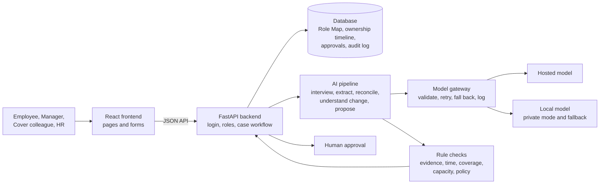

# Shetu for CSE 3422: Pitch Preparation Pack

Revision 3, 12 November 2026. For the project proposal presentation on **15 November 2026**.

This pack holds the content for the faculty workbook and the pitch. The final PPTX has **not** been generated; it will be built from section 7 once the team approves the positioning and scope.

Everything here describes what the team **proposes to build**. Each feature is labelled so the previous competition prototype is never presented as lab work:

| Label | Meaning |
|---|---|
| Prototype | Shown working on one scripted case in the GP FutureMakers competition prototype. To be rebuilt properly |
| New | First proposed for this lab. Not built |

Nothing is "completed in the lab" yet.

---

## 0. Team details (the only place to edit them)

| Field | Value |
|---|---|
| Team name | Team Anomaly |
| Member 1 | Sadia Noman Tonni, 0112420097 |
| Member 2 | Nazha Tarannum Roza, 0112420465 |
| Member 3 | Ahmad Maruf Hossain, 0112420505 |
| Member 4 | Mohammad Mahadi Hasan, 0112420506 |

Provided by the team on 12 November 2026. These also appear in cells B3 and C3 of `04-Workbook-Submission-Draft.xlsx` and on the title slide.

---

## 1. Workbook field: Idea

**Project title:** Shetu (সেতু, "bridge"): an AI system that keeps a job intact through a long leave

**For the Excel cell (about 70 words)**

> Shetu is an AI-native workforce continuity system for long leave, starting with maternity leave. Its AI interviews the employee in Bangla, English or Banglish, builds an evidence-backed map of her real job, and finds duties nobody listed. It then plans how each duty passes to colleagues before leave, re-plans when things change during leave, and plans how her work returns to her. AI proposes, rules check, people decide.

**The problem, explained**

When an employee goes on a long leave, nobody holds a full picture of her job. HR records the dates and the manager improvises the rest. Three things go wrong:

1. **Work is dropped**, because duties nobody wrote down are never handed over.
2. **The plan breaks**, because a covering colleague falls ill or a deadline moves and nobody re-plans.
3. **The return does not fit**, because she comes back to late meetings and travel that clash with the arrangement she now needs.

The company loses work and often loses the person. She loses career ground.

**Target users**

| Who | What they need from Shetu |
|---|---|
| Employee going on leave | Hand over completely, not be contacted during leave, return to a job that fits, without explaining private reasons |
| Manager | A handover plan that does not overload the team, repaired quickly when something changes |
| Covering colleague | To know exactly what they have taken on |
| HR | One consistent process, only exceptions to decide, a record of every decision |

---

## 2. Workbook field: Elevator Pitch

**The final elevator speech (63 words)** was written by Tonni on 14 November 2026. It is the text in the Excel cell, and the first thing said at the presentation, followed by the introduction.

> Companies lose experienced women after maternity leave because nobody plans her job. Shetu is AI software that maps her duties before leave, protects her role during it, and fits the job to her life before she returns. Her manager confirms every change, and all data stays on the company's own server. The company keeps the person it trained, and she keeps her career.

**The team kept her wording** (14 November 2026). The line "all data stays on the company's own server" describes what a company can do: run the AI on a local model on its own server, so employee data never leaves. In the lab build the AI is a hosted model and the data is synthetic. If asked, say exactly that: it is the design for a real company, and the lab version does not claim it. See the question in section 10.

The versions below are earlier drafts, kept for reference and for the 60-second spoken version.

**10 seconds**

> Shetu is an AI system that maps what an employee really does, hands each duty over before a long leave, keeps the plan intact while she is away, and brings her work back to her on her terms.

**20 seconds: the Excel cell until 14 November evening (58 words), replaced by the final speech**

> When someone goes on maternity leave, her work has to pass to others and come back later. Today nobody manages that properly. Shetu's AI maps what she really does, including the duties nobody listed. It plans who covers each one, re-plans when things change, and brings her work back on her terms. AI proposes, rules check, people decide.

**30 seconds: the earlier Excel cell text (about 85 words)**

> When someone goes on maternity leave, her work has to pass to others and come back to her later, and today nobody manages that properly. Shetu's AI interviews her in Bangla, English or Banglish, builds an evidence-backed map of her real job, and finds the duties nobody listed. It plans who takes each duty and when, re-plans when a colleague becomes unavailable or a deadline moves, and plans her return around the arrangement she needs. AI proposes, rules check, people decide.

**60 seconds: expanded verbal pitch**

> Companies train experienced women and then lose them around maternity leave. Not because of the leave itself, but because nobody really knows what her job is. Work gets dropped, the cover plan breaks the first time something changes, and she returns to a job that no longer fits her life.
>
> Picture an hourglass. Before leave, her duties narrow as they pass to colleagues. During leave, others hold them. On return, they widen back to her. Shetu manages that whole shape.
>
> Before leave, our AI interviews her in Bangla, English or Banglish and builds a Role Map where every duty links to her own words or a document, and it asks about work she did not mention. During leave, a manager can simply type what changed, and Shetu works out what is affected and proposes a new plan. Before she returns, it finds every clash with the arrangement she needs.
>
> A form cannot do this, because a form only records what people remember. The AI proposes, rules check every proposal, and a person always decides.

---

## 3. Workbook field: USP

**For the Excel cell**

> Shetu works on the job itself, not the leave paperwork. It finds work nobody listed, keeps every duty owned on every day of the leave, and proposes a new plan when things change. Every AI statement is traceable to the employee's own words or a document, and is approved by a person before it counts.

**Supporting points for the slide**

1. **It finds what a meeting misses.** The AI asks its own follow-up questions and compares her account with her documents.
2. **It adapts.** A manager types what changed in ordinary words; Shetu understands it and repairs the plan.
3. **Every claim shows its evidence.** Each duty is marked said, documented, or suggested. A suggestion is a question, never a fact.
4. **AI never decides.** Rules check each proposal against capacity and policy; a manager or HR approves.

**A caution.** The competition documents claimed no product does this in Bangladesh. That has not been verified. Say "unlike typical HR and leave-management systems, which record dates and approvals", and avoid "the only".

---

## 4. Workbook field: Project Features

### 4.1 Short list for the Features cell

1. Adaptive AI interview about the job, in Bangla, English or Banglish
2. Evidence-backed Role Map that the employee confirms
3. AI comparison of her account with her job description and documents
4. Questions about duties she may have missed
5. AI handover proposals checked against team capacity
6. Ownership timeline: every duty has an owner on every date
7. Plain-language change reporting with AI re-planning during leave
8. Return planning: clashes found by rules, fixes proposed by AI
9. Role-based access, HR approvals and a full decision log

### 4.2 Module breakdown in the workbook's format

This is the core MVP: what the team commits to. The fifth column is for the team's own reference and is not in the workbook draft.

| Module | Sub-module | Features | Description | Status |
|---|---|---|---|---|
| Employee | MAP: describe the job | Adaptive role interview | She describes her work by typing in Bangla, English or Banglish. The AI reads each answer and chooses the next question from what is still missing: timing, place, who depends on it | New |
| | | Evidence-backed Role Map | The AI converts her answers into a list of duties with frequency, timing, place and importance, each linked to her exact words. Rules re-check every date, time and number | Prototype |
| | | Confirm and correct | She reviews every duty and can edit or reject it. Nothing is shared with her manager until she confirms | New |
| | MAP: check against documents | Document comparison | She pastes her job description or a handover note. The AI matches each statement to her duties and lists what the document mentions that she did not, and where the two disagree | Prototype (job description only) |
| | | Possible missing duties | Each unmatched or AI-suggested duty appears as a question marked "suggested". It joins the Role Map only if she confirms it | New |
| | FIT: plan the return | State return needs | She enters the arrangement she needs: finish time, days from home, travel limits. No reason is asked or stored | New |
| | | Review return plan | She sees each clash found, the fix agreed, and the date each duty returns to her, and can ask HR to review | New |
| Manager | MAP: plan the handover | Handover proposal | The AI proposes who takes each duty and from what date, with a reason. Rules check each proposal against the colleague's capacity and reject overloads | New |
| | | Ownership timeline | Shows who owns every duty on every date. A rule blocks any plan that leaves a duty without an owner | New |
| | | Approve handover | The manager accepts, changes or rejects each proposal. Nothing takes effect without approval | New |
| | HOLD: manage changes | Report a change in plain words | The manager types what changed, for example "Tania will be unavailable for three weeks and the report deadline has moved to April 2". The AI extracts the person, the period and the new date, and shows its reading for confirmation | New |
| | | Impact analysis | Rules list every duty left uncovered or late, and every colleague pushed over capacity, by the change | New |
| | | Revised plan | The AI proposes a repaired handover plan. Rules re-check it. The manager approves | New |
| | FIT: resolve clashes | Clash detection | Rules compare her stated needs with each duty's timing, place and travel | Prototype |
| | | Fix proposals | The AI proposes two or three specific fixes per clash: move a meeting, reassign, start earlier. Rules reject options that break policy or capacity and show the reason. The manager confirms one | Prototype |
| Cover colleague | HOLD: covered duties | My duties | Sees only the duties assigned to them, with the handover details for each | New |
| HR | Leave cases | Open and track cases | Opens a leave case and sees each case's stage and open issues | New |
| | Approvals | Review queue | Decides clashes with no accepted fix, and any permanent change to a duty held in the employee's name. A reason is recorded | New |
| | Audit | Decision log | Lists every AI proposal, rule verdict and human decision, with who and when | New |
| | Settings | Policy and team | Maintains flexible-work rules, team members and manager-estimated capacity used by the rule checks | New |
| All users | Access | Login and roles | Each role sees only what it needs. Permissions are checked on the server for every page | New |

### 4.3 What comes after the MVP

| Tier | Features |
|---|---|
| Next priorities, if time allows | Hourglass chart of her workload over time; AI-ordered handover and return with knowledge-transfer briefs; single-point-of-failure flags; Ask-the-Handover (cover colleagues ask questions and get cited answers); file upload; close-and-purge |
| Stretch | Role-cycle suggestions; return briefing; follow-up check after return; calendar export as a source; HR overview; Bangla voice input |
| Excluded on purpose | Live calendar, email or HR-system integrations; autonomous agents; any score or prediction about a person; fixed workload percentages; payments; multiple organisations |

---

## 5. How the product works: one architecture

**The idea in one sentence.** The Role Map lists her duties; each duty has an owner on every date; the hourglass is the shape those ownership changes make; Map, Hold and Fit are the three stages that manage it.

```
 duties she holds
 ████████████▇▆▅▃▂▁                    ▁▂▃▅▆▇████████████
 |---------- MAP ---------|--- HOLD ---|--------- FIT ---------|
  understand the job,       others hold   plan her return,
  hand each duty over       her duties;   duty by duty, around
  on an agreed date         re-plan on    the arrangement
                            change        she needs
                         leave starts   leave ends
```

The schedule is agreed individually for each person. Shetu never prescribes a percentage of workload; the curve is simply what the agreed plan looks like.

**Who does what**

| AI does | Rules do | People do |
|---|---|---|
| Understands mixed-language conversation | Dates, times, leave windows | Confirm the Role Map |
| Extracts duties with their evidence | "No duty is ever unowned" | Approve the handover |
| Asks follow-up questions | Capacity arithmetic | Approve re-plans |
| Matches documents to duties | Policy limits and permissions | Decide exceptions (HR) |
| Reads a change described in words | Finds what a change affects | Everything final |
| Drafts handover, repair and return proposals | Accepts or rejects each proposal, with a reason | |

**Why AI is essential.** Take the AI out and Shetu becomes a form that records what people remember, which is the manual process it replaces. Understanding free speech in mixed Bangla and English, noticing what is absent, reconciling it with documents, and reading "Tania is away for three weeks" are things rules cannot do. The AI is in all three stages, and it is bounded by rules and human approval so it can be trusted with a sensitive subject.

**System architecture**



Two parts that talk through one JSON API: a React frontend and a FastAPI backend. The AI pipeline is a module inside the backend, not a separate service. The gateway means the model provider can change without touching the rest.

---

## 6. Technology stack

Every member should be able to give the reason in the right-hand column.

| Layer | Proposed | Why it suits this project |
|---|---|---|
| Backend | Python with FastAPI | Recommended by our instructor. Python means the AI code and rule checks plug in directly. FastAPI is built on Pydantic, the same tool we use to validate AI output, and it documents the API automatically |
| Frontend | React (built with Vite), plain components | Recommended by our instructor. A separate frontend lets frontend and backend members work in parallel |
| Between them | A JSON API | One clear contract that both sides can read and test |
| Database | SQLite through SQLAlchemy | A single file, identical on every laptop; can move to PostgreSQL by configuration |
| AI model | A hosted model through our own gateway; local Qwen3-4B as fallback and private mode | Whole team can use it; provider can be swapped; an offline mode exists for sensitive data |
| AI output control | JSON Schema plus Pydantic validation | A reply that does not match the expected shape is rejected and retried |
| Testing | pytest for the backend and rules, Selenium for user flows | Selenium is required by the course |
| Collaboration | GitHub: Issues, feature branches, pull requests, reviews, CI | Required by the course; shows who built what |

**Status.** Python and the local model exist in the prototype (which used Flask). Everything else is proposed. Deliberately not used: Redux, Next.js, microservices, vector databases, agent frameworks. **The hosted model is not yet chosen:** it will be selected by running the same synthetic test cases through each candidate. If asked, the honest answer is "a Gemini Flash-class model is our leading candidate; we choose after measuring".

**Likely cost.** On a free tier with synthetic data, nothing. On a paid mid-tier model, an estimated 14 US cents per full case and roughly 40 to 135 dollars across the whole term in a generous scenario; much less on smaller models. Details and assumptions are in the report, section 19.

---

## 7. Presentation structure

No official time limit is known; the estimate is 5 to 10 minutes. The deck is **ten slides, about six and a half minutes**, with no appendix: this is a class proposal, not a competition pitch. Deeper questions are answered from section 10 of this pack, not from extra slides.

### 7.1 The deck: `05-Shetu-Proposal-Deck.pptx`

| # | Slide | On the slide | Say | Time |
|---|---|---|---|---|
| 1 | Title | "Map her job. Hold her role. Fit her return." Team Anomaly and the four members | The final elevator speech (section 2), then the introduction | 0:45 |
| 2 | The problem | An illustrative job card (what the job description says, what nobody wrote down), the three failures, the Bangladesh Bank news clipping | Say the example is illustrative | 0:50 |
| 3 | Our solution | The bridge with Map, Hold and Fit, and seven duties on an ownership timeline that narrows and widens like an hourglass | Explain the hourglass; no fixed percentages | 0:55 |
| 4 | Why AI is essential | Her Banglish sentence turning into Role Map rows marked Said, Documented, Suggested; AI, Rules, People | "Without AI this is a form." | 0:50 |
| 5 | Hold: when things change | The Tania message, what the AI understood, the impact, the checked proposal, Approve or Change | The most AI-native part; working by the 60% update | 0:50 |
| 6 | Features and USP | What each of the four users can do, by stage; the USP | What we commit to build | 0:40 |
| 7 | Architecture and technology | React, FastAPI, the AI pipeline, the model gateway; the stack table | One reason per choice; the model is chosen by testing | 0:45 |
| 8 | How we will know it works | Fake test cases in Bangla, English and Banglish; six things we measure; how the model is chosen; what Shetu will never do | Answers the lab's "how do we know it works?"; no results yet | 0:45 |
| 9 | Plan and scope | The four checkpoints on the bridge; what we cut; honest limits; how we work | Realistic commitment | 0:40 |
| 10 | Close | "Keep the people you trained." | Thank you; invite questions | 0:10 |

Total about 7:10. If the limit turns out to be five minutes, shorten slides 2, 6 and 9 rather than dropping a slide.

### 7.2 Who presents what

Agreed by the team on 14 November 2026.

| Speaker | Slides | Topic |
|---|---|---|
| Tonni | 1, 2, 3 | The elevator speech and introduction, the problem, the solution |
| Mohammad Mahadi Hasan | 4, 5 | Why AI is essential, HOLD re-planning |
| Ahmad Maruf Hossain | 6, 7 | Features and USP, architecture and technology |
| Nazha Tarannum Roza | 8, 9, 10 | How we will know it works, the plan, the close, and answering the questions |

### 7.3 Deck rules

From the faculty note: clean and professional, Canva or PPTX only, presented full-screen. Team preference: no decorative emoji, a calm palette, one idea per slide, and "illustrative data" marked wherever example data appears. Do not put statistics on a slide without their source; the verified figures are in `reference/competition/HANDOFF - Shetu Round 2.md`, section 5.

---

## 8. Scope, limitations and risks to state openly

**In scope.** One organisation, typed input in three language forms, the core MVP in 4.2.

**Limitations.**

- All data is synthetic and written by the team. Measured results will describe that data only.
- No employer, HR professional or returning mother has been interviewed or has used the system.
- AI output can be wrong. The design assumes this, which is why every item needs evidence and human confirmation.
- Team capacity is a manager's estimate, not a measurement.
- The competition prototype handled a single scripted case. What is proposed here is a new build that reuses its ideas and some of its checks.

**Top risks.** Scope against the term length; model quality on Banglish; careful handling of a sensitive subject.

---

## 9. Team working method

Preliminary and **unassigned** until members' skills and availability are provided. Full detail is in the report, section 25.

| Role | Primary area | Feature owned end to end |
|---|---|---|
| A | Frontend | MAP: interview and Role Map confirmation |
| B | Backend and database | Ownership timeline, handover planning and approvals |
| C | AI integration and evaluation | HOLD: change understanding and re-planning |
| D | Testing and documentation | FIT: return needs, clashes and fixes |

Each member commits from their own GitHub account, works on a feature branch per Issue, and merges through a pull request reviewed by another member. Every member can explain and modify their own modules. AI assistants are used openly and recorded in `AI-USAGE.md`.

---

## 10. Questions the faculty may ask, with honest answers

| Question | Answer |
|---|---|
| Is this just a chatbot? | No. The conversation is the input. The product is the Role Map, the gaps it finds, and the plans it proposes and repairs |
| What happens when the AI is wrong? | Every item needs a matching quote or document; numbers and times are recomputed by rules; a person confirms. Unsupported items are flagged, not hidden |
| Which model? | Not fixed yet. It sits behind our own gateway, we will measure candidates on the same test cases, and a local open model can run fully offline |
| How do you know it works? | A set of synthetic scenarios with answer keys in Bangla, English and Banglish, scored on six metrics. Team-written data, reported as such. No results yet |
| Did you build this before? | The concept and a one-case prototype come from the GP FutureMakers competition, as you know. The application proposed here is a new build; the repository history will show it |
| What is the hourglass? | The shape her workload takes: narrowing before leave, held by others during it, widening on return. Map, Hold and Fit manage those three parts. No fixed percentages; each plan is agreed individually |
| Does it need payments? | No. It is licensed to an employer and invoiced; the application has no payment flow |
| Is maternity data sensitive? | Yes, so we collect almost none: duties, dates and the arrangement she needs. Never the reason, never medical detail |
| Does all the data really stay on the company's own server? | That is how Shetu is designed for a real company: the AI can run on a local model on the company's own server, so employee data never has to leave. For this lab we use a hosted model with synthetic data only, and we have not claimed otherwise |
| What did you cut? | Live integrations, autonomous agents, and anything that scores people. Voice input is a planned extra for later, not in the first version, because typed Banglish already gives us the AI interview |
| Did you use AI to write code? | Yes, as the course encourages. Tools and where they were used are recorded in the repository, and every member can explain their code |
| Who built what? | Each member will own a feature end to end; the commits, pull requests and reviews show it |

---

## 11. Pitch-day checklist

- [x] Team name and members provided and entered (section 0, workbook B3 and C3, title slide)
- [ ] Workbook submitted: idea, elevator pitch, features, USP, module breakdown
- [x] Positioning and scope approved by the team (12 November, "approved for now")
- [ ] Deck built in PPTX or Canva and tested in full-screen mode
- [ ] Every member can say the 30-second pitch
- [ ] Every member can explain the hourglass slide, the architecture diagram and each stack choice
- [ ] Limitations stated honestly: synthetic data, no user research, model not yet chosen
- [ ] All members present
- [ ] Full formal dress, including formal shoes and a belt
- [ ] Backup copy of the deck on a second device
